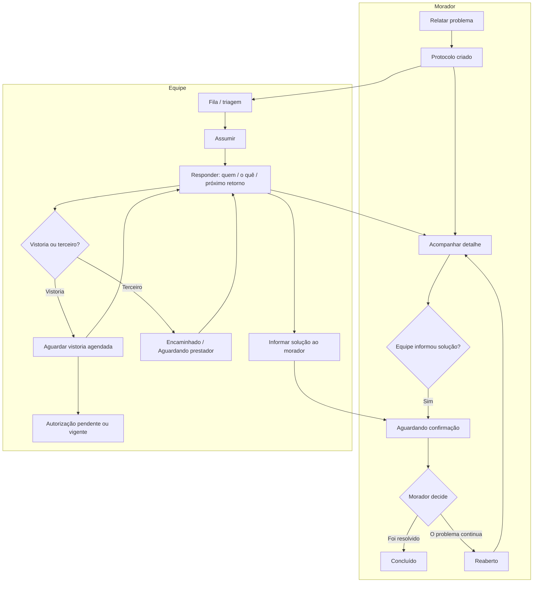
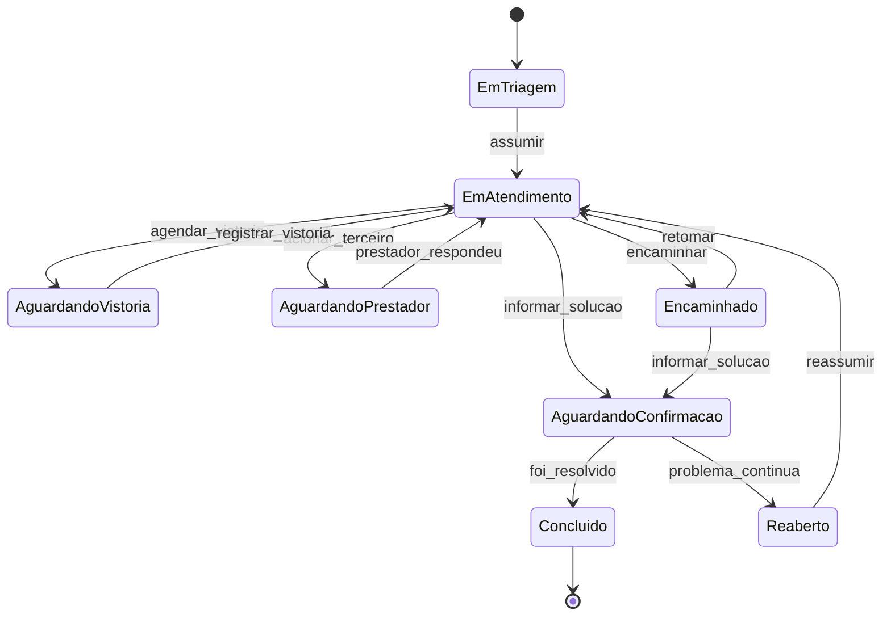
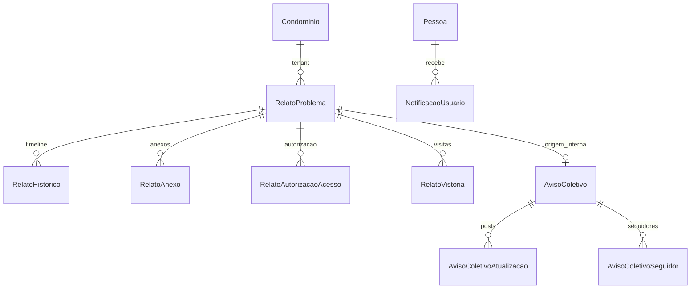

# Planejamento — Relatar um problema (AppCondominium)

Documento para alinhamento entre **produto**, **desenvolvimento** e **gestão do condomínio**. Versão consolidada com base no repositório atual e no plano interno. Referência anterior: [`docs/AppCondominium - Planejamento de relatos.docx`](AppCondominium%20-%20Planejamento%20de%20relatos.docx).

**Escopo deste arquivo:** apenas planejamento. Não inclui código, migrações nem alterações em banco.

**Versão para implementação.** Regras firmes desta revisão:

| # | Regra | Entrega |
|---|--------|---------|
| R1 | Anexos: indicador `possuiAnexo` só para equipe sem designação; binário via API com checagem a cada request (sem URL pública ao S3) | E1 |
| R2 | `OrigemApurada`: `NULL` / `0` / `1–5`; inconclusiva → `0` + `RelatoVistoria`; encaminhar investigação com origem desconhecida | E2 |
| R3 | Agendar vistoria com autorização **pendente**; registrar visita só com autorização **vigente** e horário dentro da janela | E2 |

Demais decisões de produto não listadas na §9 permanecem em aberto. **Não há bloqueio técnico para iniciar a E1** (ver §11).

---

## 1. Resumo da proposta e diagnóstico do repositório

### 1.1 Objetivo

Permitir que o morador registre um pedido de reparo ou irregularidade (em área comum ou dentro do apartamento) e acompanhe o atendimento com respostas claras a:

1. **Quem está cuidando**
2. **O que já foi feito**
3. **Quando receberei o próximo retorno**

A equipe (portaria, manutenção, gestão) triagem, assume, investiga, encaminha e informa a solução. O morador **confirma** se foi resolvido ou indica que **o problema continua**, sempre no **mesmo protocolo** e com **histórico preservado**.

### 1.2 Stack e organização

| Camada | Tecnologia | Evidência no repositório |
|--------|------------|---------------------------|
| Backend | .NET 8, EF Core + Pomelo MySQL, JWT | [`WebApi/AppCondominium.sln`](../WebApi/AppCondominium.sln), [`WebApi/AppCondominium.API/Program.cs`](../WebApi/AppCondominium.API/Program.cs) |
| Frontend web | Angular 18 standalone, RBAC por `permissionKey` | [`frontend/package.json`](../frontend/package.json), [`frontend/src/app/app.routes.ts`](../frontend/src/app/app.routes.ts) |
| Banco | MySQL, script canônico | [`database/schema.sql`](../database/schema.sql) |
| Geração CRUD | Spec JSON + Python | [`MDs/md_appCondominium.json`](../MDs/md_appCondominium.json), [`tools/generate_from_spec.py`](../tools/generate_from_spec.py) |
| App móvel (scaffold) | Flutter 3, login/menu sem relatos | [`AppCondominium/lib/main.dart`](../AppCondominium/lib/main.dart), [`README.md`](../README.md) |

### 1.3 O que existe e pode ser reaproveitado

| Capacidade | Reaproveitar | Caminhos |
|------------|--------------|----------|
| Multi-tenant (`IdCondominio`) | Sim | [`ICondominioContext`](../WebApi/AppCondominium.Application/Interfaces/ICondominioContext.cs), [`CondominioContextMiddleware.cs`](../WebApi/AppCondominium.API/Middleware/CondominioContextMiddleware.cs), filtros EF em [`AppDbContext.TenantFilters.Generated.cs`](../WebApi/AppCondominium.Infrastructure/Persistence/AppDbContext.TenantFilters.Generated.cs) |
| Login e vínculo morador | Sim | [`AuthController.cs`](../WebApi/AppCondominium.API/Controllers/AuthController.cs), regras em [`MDs/md_appCondominium.json`](../MDs/md_appCondominium.json) |
| Bloco / unidade / pessoa | Sim | Entidades em [`WebApi/AppCondominium.Domain/Entities/Generated/`](../WebApi/AppCondominium.Domain/Entities/Generated/), telas em [`frontend/src/app/features/`](../frontend/src/app/features/) |
| RBAC | Sim | [`docs/rbac/funcionalidades-catalogo.json`](rbac/funcionalidades-catalogo.json), [`PermissionResourceAttribute.cs`](../WebApi/AppCondominium.API/Authorization/PermissionResourceAttribute.cs) |
| Anexos S3 | Sim | [`ArquivoAplicacao.cs`](../WebApi/AppCondominium.API/Storage/ArquivoAplicacao.cs), [`StorageObjectKeyBuilder.cs`](../WebApi/AppCondominium.Application/Storage/StorageObjectKeyBuilder.cs), padrão em [`PessoaUnidadeArquivoController.cs`](../WebApi/AppCondominium.API/Controllers/PessoaUnidadeArquivoController.cs) |
| UI anexo web | Sim | [`arquivo-anexo.component.ts`](../frontend/src/app/shared/arquivo-anexo/arquivo-anexo.component.ts) |
| Shell único morador + gestão | Sim | Menu por permissão em [`app.component.ts`](../frontend/src/app/app.component.ts), login tenant em [`login-condominio.component.ts`](../frontend/src/app/features/auth/login-condominio.component.ts) |

### 1.4 O que não existe (criar)

- Módulo de relato/chamado (sem entidades nem rotas em backend ou frontend).
- Notificações persistidas no backend (apenas toast local: [`toast.service.ts`](../frontend/src/app/core/services/toast.service.ts)).
- Contato de plantão em configuração (hoje `ConfiguracaoCondominio` só tem `CorPadrao` — ver [`database/schema.sql`](../database/schema.sql) linhas 79–85 e entidade gerada).
- Fluxo morador na web além do `HOME` placeholder ([`home.component.ts`](../frontend/src/app/features/home/home.component.ts)).

### 1.5 Perfis do sistema vs papéis do condomínio

Perfis cadastrados: Administrador, Síndico, Subsíndico, Conselheiro, Funcionário Administração, funcionário Manutenção, Proprietário, Morador — [`docs/rbac/concessoes-perfil.json`](rbac/concessoes-perfil.json). **Não há** perfis literais “Portaria” ou “Zeladoria”.

| Papel no condomínio | Perfil no AppCondominium (recomendação) | Validação |
|---------------------|----------------------------------------|-----------|
| Morador / proprietário | Morador / Proprietário | — |
| Portaria | Funcionário Administração | **Decisão pendente:** criar perfil Portaria ou manter mapeamento |
| Zeladoria / manutenção | funcionário Manutenção | Idem |
| Gestão | Síndico, Subsíndico, Administrador | — |

### 1.6 Abordagem técnica

O gerador [`tools/generate_from_spec.py`](../tools/generate_from_spec.py) serve a CRUD simples. **Relatos exigem** máquina de estados, privacidade, idempotência e endpoints de ação. Recomendação: entidades **manuais** (fora de `Generated/`), `AppDbContext` partial, controllers dedicados (como anexos), script em `database/migrations/` quando for implementar.

---

## 2. Jornada do morador e da equipe (três casos)

### 2.1 Fluxo completo até confirmação



**Regra de encerramento:** a equipe **não** encerra o chamado sozinha. A ação **Informar solução** leva o estado para **Aguardando confirmação**. Só após **Foi resolvido** o estado passa a **Concluído**. **O problema continua** → **Reaberto** → retoma **Em atendimento** (mesmo `NumeroProtocolo`, histórico intacto).

### 2.2 Três conceitos distintos (exemplo vazamento)

| Conceito | Momento | Exemplo no vazamento no banheiro |
|----------|---------|----------------------------------|
| **Local observado** | Abertura (morador) | “Água saindo pelo rodapé do banheiro da suíte” |
| **Origem apurada** | Após investigação (equipe) | **Não investigada** na abertura (`NULL`) → após vistoria inconclusiva: **ainda desconhecida** (código `0`, com registro em `RelatoVistoria`) → após identificação: `TubulacaoColetiva` / `OutraUnidade` / `UnidadePropria` |
| **Responsável pela próxima providência** | Atualizado a cada passo | Início: síndico/portaria (interno). Depois: empresa de encapsulamento (terceiro). O **próximo retorno ao morador** é dado pelo **responsável interno de registro** (`IdResponsavelRetorno`), mesmo quando o executor é terceiro |

**Mensagem ao morador (encaminhamento):**  
*“Encaminhamos o caso ao encanador contratado. Quem cuida do seu retorno: Maria (administração). Próximo retorno: 14/11 até 17h.”*

### 2.3 Caso A — Vazamento no banheiro (apartamento)

1. **Morador:** âmbito *Dentro da unidade*; local observado; “ainda vazando”; foto opcional. **Privado por padrão** — não define origem nem responsabilidade legal.
2. **Portaria (Func. Administração):** pode **agendar** a visita com autorização ainda **pendente** (§3.9). No detalhe, vê apenas `possuiAnexo: true/false` — sem nome de arquivo, miniatura, prévia ou link. Registra ou confirma **autorização de acesso** quando o morador autorizar.
3. **Manutenção (`IdResponsavelAtual`):** só **registra vistoria** se existir autorização **vigente** e o horário efetivo da visita cair na janela. Se **inconclusiva**, `OrigemApurada` passa a **`0`**, protocolo aberto, próxima providência e retorno ao morador (§3.8). Pode **encaminhar a especialista** para continuar investigação mesmo com origem `0`. Segunda visita **conclusiva** atualiza origem (`3` tubulação coletiva, etc.) preservando visitas em `RelatoVistoria`.
4. **Solução informada** → morador em **Aguardando confirmação** → confirma ou reabre.

**Entrega:** fluxo completo na **segunda entrega** (vistoria + origem + foto). A primeira entrega usa o caso C.

### 2.4 Caso B — Elevador parado (coletivo)

1. **Morador A** abre relato (área comum, bloco).
2. **Gestão** cria **aviso coletivo** (texto público) vinculado ao relato de origem — **sem expor** nome, unidade nem anexos de A.
3. **Moradores B…N** clicam **Quero acompanhar** → inscrição na tabela de seguidores do aviso. **Não cria protocolo adicional.**
4. Com 40 acompanhantes: **1 aviso**, **40 seguidores**, atualizações públicas no aviso; cada um recebe notificação in-app. O relato original de A permanece **privado** (conversa só solicitante + equipe).

**Entrega:** **segunda entrega** (tabelas `AvisoColetivo*`).

### 2.5 Caso C — Vaga de garagem bloqueada (primeira entrega E2E)

1. Morador registra irregularidade (garagem), sem vistoria.
2. Portaria/gestão assume, responde com providência e `PrazoRetorno`.
3. Encaminha à administração (pode ficar em **Em atendimento** ou **Encaminhado** sem prestador externo).
4. Equipe **informa solução** → **Aguardando confirmação** → morador **Foi resolvido** ou **O problema continua**.

Demonstra o fluxo mínimo **ponta a ponta na web**, sem coletivo, vistoria ou plantão.

---

## 3. Regras de negócio, estados e permissões

### 3.1 Campos na abertura (mínimo)

| Campo | Obrigatório na abertura | Observação |
|-------|-------------------------|------------|
| Categoria | Sim | Catálogo por condomínio (`RelatoCategoria`) |
| Descrição | Sim | Texto livre |
| Âmbito | Sim | `AreaComum` \| `DentroUnidade` |
| Local observado | Sim | Texto |
| Unidade do solicitante | Sim (derivado) | Vínculo `PessoaUnidade` no login |
| Bloco | Condicional | Área comum / aviso por bloco |
| Ainda ocorre / urgência | Opcional | Urgente exibe plantão (**2ª entrega**) |
| Anexo | Opcional | Imagens, limites em [`StorageMedia`](../WebApi/AppCondominium.Application/Storage/StorageMedia.cs) |
| Chave de idempotência | Recomendado | Header `Idempotency-Key` |

**Origem apurada — interpretação única (E2):**

| Valor | Significado |
|-------|-------------|
| `NULL` | Ainda **não houve investigação** da origem (nenhuma vistoria registrada). |
| `0` | Houve **vistoria** e a origem **continua desconhecida** (ao menos uma `RelatoVistoria` com `Resultado = Inconclusiva`; o sistema define `0` automaticamente nesse registro). |
| `1`–`5` (+ `OrigemApuradaTexto` se `5=Outro`) | Equipe **apurou e registrou** a causa (vistoria conclusiva ou atualização auditada). |

**Obrigatoriedade:** **Informar solução** com reparo concluído, se `ExigeOrigemApurada = 1`, exige `1`–`5`. **Encaminhar** a especialista **para investigação** é permitido com `NULL` ou `0`. Vistoria inconclusiva atualiza providência, `IdResponsavelRetorno` e `PrazoRetorno` sem fechar o caso.

**Prazo de retorno** ≠ **previsão de conclusão:** o primeiro é compromisso de comunicação; o segundo, estimativa de obra.

### 3.2 Quem dá o próximo retorno quando há terceiro

| Situação | Responsável pelo próximo retorno ao morador | Registro |
|----------|---------------------------------------------|----------|
| Atendimento interno | `IdResponsavelRetorno` (pessoa da equipe) | Nome exibido no detalhe |
| Encaminhado a empresa / prestador | **Sempre** um responsável **interno** (`IdResponsavelRetorno`) | Campo `ResponsavelExternoTexto` descreve o terceiro; mensagem pública cita os dois |
| Aguardando prestador | Interno monitora e atualiza `PrazoRetorno` | Estado `AguardandoPrestador` |

Terceiros **não acessam** o sistema nesta fase.

### 3.3 Estados do chamado

| Estado | Quem vê destaque | Transições principais |
|--------|------------------|------------------------|
| `EmTriagem` | Fila sem responsável | → `EmAtendimento` (assumir) |
| `EmAtendimento` | Responsável + prazo | → `AguardandoVistoria`, `AguardandoPrestador`, `Encaminhado`, `AguardandoConfirmacao` |
| `AguardandoVistoria` | Visita agendada; autorização pode estar pendente (§3.9) | → `EmAtendimento` só via `registrar-vistoria` com autorização vigente |
| `AguardandoPrestador` | Terceiro acionado | → `EmAtendimento` / `Encaminhado` |
| `Encaminhado` | Pode incluir investigação externa com origem `0` | ≠ reparo concluído; → `EmAtendimento` (retomar) |
| `AguardandoConfirmacao` | Morador deve responder | → `Concluido` (morador) ou `Reaberto` (morador) |
| `Reaberto` | Histórico preservado | → `EmAtendimento` (equipe reassume) |
| `Concluido` | Terminal | Reabertura só na **E2** via `POST .../reabrir` (§3.6 e §9) — distinto de **O problema continua** em `AguardandoConfirmacao` |
| `Cancelado` | Duplicata | Terminal |



**UI:** destacar chamados sem `IdResponsavelAtual`, com `PrazoRetorno` vencido, e em `AguardandoConfirmacao` há mais de X dias (**recomendação:** 7 dias para lembrete ao morador — validar).

### 3.4 Privacidade

#### Relato privado (padrão em `DentroUnidade`)

| Recurso | Solicitante (autor) | Outro morador (mesma unidade) | Equipe na fila | Profissional **designado** | Gestor autorizado |
|---------|---------------------|-------------------------------|----------------|--------------------------------------|---------------------|
| Ver protocolo e timeline **pública** | Sim | **Não** (404) | `ATENDIMENTO_RELATO:Visualizar` | Idem | Idem |
| Enviar mensagem na timeline pública | Sim | Não | `ATENDIMENTO_RELATO:Alterar` | Idem | Idem |
| Notas internas | Não | Não | `RELATO_NOTA_INTERNA:Incluir` | Idem | Idem |
| Campo API `possuiAnexo` (boolean) | Sim | Não | Sim, **somente isso** sobre anexo | Sim | Sim |
| Miniatura, prévia, download, nome do arquivo | Sim (§3.7) | **Não** | **Não** — resposta **não** inclui lista de anexos nem URLs | Sim (§3.7) | Sim (§3.7) |

Equipe na fila **sem** designação e **sem** gestão: o DTO de atendimento expede `possuiAnexo` e **omite** o array `anexos`, `urlMiniatura`, `urlDownload` e `nomeOriginal`.

\*\***Gestor autorizado** no condomínio: `AcessoTotal` no token, ou perfil **Administrador** / **Síndico** / **Subsíndico** com `ATENDIMENTO_RELATO:Visualizar` resolvido por [`IPermissionResolver`](../WebApi/AppCondominium.Infrastructure/Services/PermissionResolver.cs) no tenant ativo (padrão [`ContaController`](../WebApi/AppCondominium.API/Controllers/ContaController.cs): autenticação + vínculo, regra no serviço).

**Vazamento — agendar vistoria (portaria):** protocolo, unidade, bloco, contato, local observado, `dataHoraVistoriaAgendada`, situação da autorização (`Pendente` / `Vigente` / `Revogada`), `possuiAnexo`. **Nenhum** metadado de arquivo além do boolean.

**Recomendação (validar):** cônjuge/outro morador da **mesma unidade** não vê o relato na v1.

#### Aviso coletivo

| Recurso | Seguidores | Não seguidores | Equipe |
|---------|------------|----------------|--------|
| Texto do aviso e atualizações | Sim | Sim (leitura pública no condomínio — **decisão pendente:** só seguidores ou todo morador logado) | Editar com `RELATO_AVISO_COLETIVO` |
| Dados do relato originador | Não | Não | Sim no painel interno |
| Protocolo pessoal do originador | Só o originador | — | Sim |

### 3.5 RBAC — chaves novas

Inseridas via catálogo [`docs/rbac/funcionalidades-catalogo.json`](rbac/funcionalidades-catalogo.json) e sync [`PermissionCatalogSync.cs`](../WebApi/AppCondominium.API/Authorization/PermissionCatalogSync.cs) nas linhas de `PermissionKey` / `PerfilPermissao` (**sem alterar estrutura** das tabelas).

| permissionKey | Morador | Portaria* | Manutenção | Gestão |
|---------------|---------|-----------|------------|--------|
| `RELATO_PROBLEMA` | **Incluir**, **Visualizar** (meus) — **sem Alterar** | — | — | Visualizar** |
| `ATENDIMENTO_RELATO` | — | Visualizar, Alterar | Visualizar, Alterar | Visualizar, Alterar |
| `RELATO_NOTA_INTERNA` | — | Incluir | Incluir | Incluir |
| `RELATO_AVISO_COLETIVO` | — | — | — | Incluir, Alterar |
| `RELATO_CONFIG` | — | — | — | Alterar |

\*Perfil mapeado: Funcionário Administração.  
\*\*Gestão enxerga fila; notas internas exigem `RELATO_NOTA_INTERNA`.

**Importante:** confirmar solução **não** usa `RELATO_PROBLEMA:Alterar` (evita edição geral do chamado pelo morador). Ver §3.6.

Endpoints de workflow da equipe (`POST .../assumir`, `.../informar-solucao`) exigem `ATENDIMENTO_RELATO` no serviço de domínio, além do padrão [`PermissionResourceAttribute`](../WebApi/AppCondominium.API/Authorization/PermissionResourceAttribute.cs) quando aplicável.

### 3.6 Confirmação do autor (E1) — sem `Alterar` no RBAC

Padrão do repositório: rotas da conta usam `[Authorize]` e validam **identidade + tenant + regra de negócio** no controller/serviço ([`ContaController`](../WebApi/AppCondominium.API/Controllers/ContaController.cs)), sem conceder CRUD amplo.

Os endpoints `POST /api/relato-problema/{id}/confirmar-resolucao` e `POST .../problema-continua`:

| Requisito | Implementação proposta |
|-----------|-------------------------|
| Autenticação | JWT + `ICondominioContext.IdCondominio` ([`CondominioContextMiddleware`](../WebApi/AppCondominium.API/Middleware/CondominioContextMiddleware.cs)) |
| Vínculo no condomínio | [`ITenantAccessService.UsuarioTemAcessoAsync`](../WebApi/AppCondominium.Infrastructure/Services/TenantAccessService.cs) |
| Autor do protocolo | `ClaimTypes.NameIdentifier` = `RelatoProblema.IdPessoaSolicitante` |
| Estado válido | Somente `Estado = AguardandoConfirmacao` |
| Efeito “Foi resolvido” | → `Concluido`, `ConcluidoEm` preenchido, uma linha em `RelatoHistorico` (`MudancaEstado`) |
| Efeito “O problema continua” | → `Reaberto`, em seguida → `EmAtendimento` (reassumir pela equipe ou manter responsáveis conforme política), histórico preservado |
| Idempotência | Segundo POST com mesmo efeito e estado já terminal da ação: **200** sem nova linha de histórico (transição condicional na mesma transação DB) |
| `PATCH` geral do relato | Morador **não** possui; 403 em qualquer tentativa de alterar campos da equipe |

**Frontend (E1):** exibir botões quando `estado === 'AguardandoConfirmacao'` **e** o detalhe é do autor (comparar `idPessoa` da sessão). **Não** usar `permissions.can('RELATO_PROBLEMA', 'Alterar')`.

**E2 — distinto:** `POST .../reabrir` após `Concluido` (regra §9) é outro fluxo; não substitui **O problema continua** em `AguardandoConfirmacao`.

### 3.7 Acesso a anexos por chamado (E1)

**Padrão do repositório:** bucket S3 **privado**; a API **entrega os bytes** via stream ([`README.md`](../README.md), [`ArquivoAplicacao.LerAsync`](../WebApi/AppCondominium.API/Storage/ArquivoAplicacao.cs), mesmo modelo de [`PessoaUnidadeArquivoController`](../WebApi/AppCondominium.API/Controllers/PessoaUnidadeArquivoController.cs)). **Não** há URLs pré-assinadas do S3 expostas ao cliente — o único endereço é da API (`GET /api/relato-problema/{id}/anexos/{idAnexo}` e variantes `/miniatura`).

**Checagem em cada acesso:** todo GET/HEAD (original, miniatura, prévia) chama `IRelatoAnexoAccessService.PodeAcessarBinario`, que **relê** `RelatoProblema` no banco (valores atuais de `IdResponsavelAtual`, `IdPessoaSolicitante`, tenant). Transferência de responsável **revoga imediatamente** o técnico anterior, mesmo que ele reutilize o mesmo URL da API com JWT antigo.

| Papel | Condição |
|-------|----------|
| **Autor** | `idPessoa == IdPessoaSolicitante` |
| **Profissional designado** | `idPessoa == IdResponsavelAtual` (**único** executor do passo atual) |
| **Gestor autorizado** | `AcessoTotal` **ou** (perfil Administrador / Síndico / Subsíndico **e** `ATENDIMENTO_RELATO:Visualizar` no condomínio via [`IPermissionResolver`](../WebApi/AppCondominium.Infrastructure/Services/PermissionResolver.cs)) |

**DTO `GET /{id}` (equipe sem binário):** `possuiAnexo: boolean` calculado por `EXISTS` em `RelatoAnexo`. **Sem** `anexos[]`, `nomeOriginal`, `urlMiniatura` nem `urlDownload`.

**DTO (autor, designado, gestor):** pode incluir `anexos: [{ idRelatoAnexo }]` — rotas relativas à API; abrir imagem **sempre** passa de novo por `PodeAcessarBinario`.

**Frontend:** não cachear blob em URL persistente para perfis de equipe; miniatura via request autenticado.

**Tenant:** `IdCondominio` inconsistente → 404.

**Teste de aceite:** **T-E1-09** (obrigatório, cenário completo na §7.1).

### 3.8 Vistoria inconclusiva e origem (E2)

1. Abertura: `OrigemApurada = NULL`.
2. `POST .../registrar-vistoria` com `resultado: Inconclusiva`, `realizadaEm` (horário efetivo da visita, §3.9):
   - Insere **`RelatoVistoria`**;
   - Define **`OrigemApurada = 0`**;
   - `RelatoHistorico` (`VistoriaRegistrada` + mensagem pública com providência e `PrazoRetorno`);
   - Estado → **`EmAtendimento`** (protocolo **aberto**).
3. Permite nova **`AguardandoVistoria`**, **`Encaminhado`** a especialista (investigação com origem `0`) ou nova vistoria — **sem** concluir reparo enquanto `ExigeOrigemApurada` e origem ∉ `1–5`.
4. Vistoria **Conclusiva** subsequente: preenche `OrigemIdentificada` na visita, atualiza `OrigemApurada` para `1–5`; **todas** as linhas em `RelatoVistoria` permanecem.

**Teste de aceite:** **T-E2-01** e **T-E2-05** (cenário obrigatório §7.2).

### 3.9 Autorização para entrar no apartamento (E2)

**Agendar sem autorização vigente:** `POST .../agendar-vistoria` coloca `AguardandoVistoria`, preenche `DataHoraVistoriaAgendada` e **pode** existir `RelatoAutorizacaoAcesso` com `Situacao = Pendente`. O agendamento **não** autoriza entrada.

**Registrar visita:** `POST .../registrar-vistoria` só aceita se:

- Existe `RelatoAutorizacaoAcesso` com `Situacao = Vigente`, `IdRelato` e unidade do protocolo;
- `realizadaEm` (corpo; padrão = agora se visita em tempo real) ∈ `[DataHoraAutorizada, DataHoraFim]` (`DataHoraFim` nulo = sem teto, **não recomendado**);
- `Situacao ≠ Revogada` e não expirada (`DataHoraFim < now` → tratada como inválida).

**Consulta antes da visita:** `GET .../autorizacao-acesso/valida?em={iso}` retorna se há janela vigente para o chamado (UI da equipe).

| Evento | Efeito |
|--------|--------|
| **Pendente → Vigente** | Morador/portaria confirma (`PATCH .../autorizacao-acesso/{id}/confirmar`) |
| **Revogação** | `Situacao = Revogada`, `RevogadoEm`; **não** registra vistoria até nova autorização vigente |
| **Expiração** | `DataHoraFim` passada → mesma validação que inválida; nova autorização ou estender via **novo** registro (histórico preservado) |
| **Reagendamento** | `PATCH .../agendar-vistoria` altera `DataHoraVistoriaAgendada`; se nova data **fora** da janela vigente, exige nova autorização ou confirmação |

Campos mínimos adicionais: §4.3 `DataHoraVistoriaAgendada`; §4.6 `Situacao`, `RevogadoEm`; §4.7 `IdRelatoAutorizacao`, `realizadaEm` informado na API (persistido em `RealizadaEm`).

**Teste de aceite:** **T-E2-06** (obrigatório, §7.2).

---

## 4. Modelo de dados (proposta)

Convenções observadas em [`database/schema.sql`](../database/schema.sql): tabelas em PascalCase, `INT UNSIGNED`, PK `Id*`, FK `fk_Tabela_Campo`, índices `uq_` / `idx_`, InnoDB utf8mb4.

### 4.1 Resumo em três listas

**Tabelas novas (proposta)**

- `RelatoCategoria`
- `RelatoProblema`
- `RelatoHistorico`
- `RelatoAnexo`
- `RelatoAutorizacaoAcesso`
- `RelatoVistoria`
- `AvisoColetivo`
- `AvisoColetivoAtualizacao`
- `AvisoColetivoSeguidor`
- `NotificacaoUsuario`

**Tabelas existentes que mudam (proposta)**

- `ConfiguracaoCondominio` — campos de plantão (**2ª entrega**)
- `PermissionKey` / `PerfilPermissao` — **apenas novos registros** (via sync), sem DDL de coluna

**Tabelas reutilizadas sem alteração**

- `Condominio`, `Bloco`, `Unidade`, `Pessoa`, `pessoafisica`, `PessoaUnidade`, `PessoaCondominio`, `PerfilAcesso`, `Equipamento`, `Local` — estruturas em [`database/schema.sql`](../database/schema.sql) e entidades em [`WebApi/AppCondominium.Domain/Entities/`](../WebApi/AppCondominium.Domain/Entities/)

**Fora do banco:** bytes de anexo em S3; nova chave proposta em `StorageObjectKeyBuilder` — `.../relatos/{idRelato}/anexos/{idAnexo}/original` (proposta de código).

---

### 4.2 `RelatoCategoria` (proposta)

**Finalidade:** tipos de relato configuráveis por condomínio (vazamento, elevador, garagem…).

| Campo | Tipo e tamanho | Aceita nulo? | Valor padrão | Chave ou referência | Finalidade | Entrega |
|-------|----------------|--------------|--------------|---------------------|------------|---------|
| IdRelatoCategoria | INT UNSIGNED | Não | AUTO_INCREMENT | PK | Identificador | E1 |
| IdCondominio | INT UNSIGNED | Não | — | FK → Condominio | Tenant | E1 |
| Codigo | VARCHAR(40) | Não | — | UNIQUE (IdCondominio, Codigo) | Chave estável (ex.: `VAZAMENTO`) | E1 |
| Descricao | VARCHAR(120) | Não | — | — | Rótulo na UI | E1 |
| ExigeOrigemApurada | TINYINT(1) | Não | 0 | — | Se 1, valida origem antes de encaminhar/solucionar | E1 |
| ExigeVistoria | TINYINT(1) | Não | 0 | — | Habilita fluxo de vistoria | E2 |
| Ordem | INT UNSIGNED | Não | 0 | — | Ordenação no formulário | E1 |
| Ativo | TINYINT(1) | Não | 1 | — | Inativo oculta na abertura | E1 |

**Regra:** seed na migração com `GARAGEM`, `VAZAMENTO`, `ELEVADOR` por condomínio ou script de carga (**decisão pendente:** seed global vs tela de config).

---

### 4.3 `RelatoProblema` (proposta)

**Finalidade:** protocolo do morador ou relato originador de aviso coletivo.

| Campo | Tipo e tamanho | Aceita nulo? | Valor padrão | Chave ou referência | Finalidade | Entrega |
|-------|----------------|--------------|--------------|---------------------|------------|---------|
| IdRelato | BIGINT UNSIGNED | Não | AUTO_INCREMENT | PK | Identificador | E1 |
| IdCondominio | INT UNSIGNED | Não | — | FK → Condominio | Tenant | E1 |
| NumeroProtocolo | VARCHAR(20) | Não | — | UNIQUE (IdCondominio, NumeroProtocolo) | Ex.: `2026-000123` | E1 |
| IdempotencyKey | VARCHAR(64) | Sim | NULL | UNIQUE (IdCondominio, IdPessoaSolicitante, IdempotencyKey) | Anti-duplicata de reenvio | E1 |
| IdPessoaSolicitante | INT UNSIGNED | Não | — | FK → Pessoa | Quem abriu | E1 |
| IdUnidade | INT UNSIGNED | Não | — | FK → Unidade | Unidade do solicitante | E1 |
| IdBloco | INT UNSIGNED | Sim | NULL | FK → Bloco | Bloco (área comum) | E1 |
| IdRelatoCategoria | INT UNSIGNED | Não | — | FK → RelatoCategoria | Categoria | E1 |
| Ambito | TINYINT UNSIGNED | Não | — | — | 1=AreaComum, 2=DentroUnidade | E1 |
| LocalObservado | VARCHAR(500) | Não | — | — | Onde o morador viu o problema | E1 |
| OrigemApurada | TINYINT UNSIGNED | Sim | NULL | — | **NULL** / **0** / **1–5** — §3.1. Sistema grava **`0`** ao registrar vistoria inconclusiva | E1 (coluna); regras E2 |
| DataHoraVistoriaAgendada | DATETIME | Sim | NULL | — | Próxima visita agendada em `AguardandoVistoria` | E2 |
| OrigemApuradaTexto | VARCHAR(500) | Sim | NULL | — | Detalhe livre da origem | E2 |
| Descricao | TEXT | Não | — | — | Relato do morador | E1 |
| AindaOcorre | TINYINT(1) | Sim | NULL | — | Situação no momento do relato | E1 |
| Urgente | TINYINT(1) | Não | 0 | — | Destaque + plantão (E2) | E1 |
| Privado | TINYINT(1) | Não | 1 | — | 1 para DentroUnidade; área comum pode ser 0 | E1 |
| Estado | VARCHAR(30) | Não | `EmTriagem` | idx (IdCondominio, Estado) | Máquina de estados §3.3 | E1 |
| IdResponsavelAtual | INT UNSIGNED | Sim | NULL | FK → Pessoa | Quem executa o passo atual | E1 |
| IdResponsavelRetorno | INT UNSIGNED | Sim | NULL | FK → Pessoa | Quem comunica o próximo retorno ao morador | E1 |
| ResponsavelExternoTexto | VARCHAR(200) | Sim | NULL | — | Nome do terceiro, se houver | E1 |
| OQueFoiFeito | VARCHAR(2000) | Sim | NULL | — | Resumo atual para o morador | E1 |
| PrazoRetorno | DATETIME | Sim | NULL | — | Compromisso de comunicação | E1 |
| PrevisaoConclusao | DATETIME | Sim | NULL | — | Estimativa de término do reparo | E1 |
| IdAvisoColetivo | BIGINT UNSIGNED | Sim | NULL | FK → AvisoColetivo | Preenchido só no relato **originador** do aviso | E2 |
| CriadoEm | DATETIME | Não | CURRENT_TIMESTAMP | — | Abertura | E1 |
| AtualizadoEm | DATETIME | Sim | NULL ON UPDATE | — | Última alteração | E1 |
| InformadoSolucaoEm | DATETIME | Sim | NULL | — | Quando entrou em AguardandoConfirmacao | E1 |
| ConcluidoEm | DATETIME | Sim | NULL | — | Confirmação do morador | E1 |

**Índices adicionais:** `idx_RelatoProblema_Fila` (`IdCondominio`, `Estado`, `IdResponsavelAtual`, `PrazoRetorno`).

---

### 4.4 `RelatoHistorico` (proposta)

**Finalidade:** linha do tempo append-only (público + auditoria de estados).

| Campo | Tipo e tamanho | Aceita nulo? | Valor padrão | Chave ou referência | Finalidade | Entrega |
|-------|----------------|--------------|--------------|---------------------|------------|---------|
| IdRelatoHistorico | BIGINT UNSIGNED | Não | AUTO_INCREMENT | PK | — | E1 |
| IdRelato | BIGINT UNSIGNED | Não | — | FK → RelatoProblema | Protocolo | E1 |
| IdCondominio | INT UNSIGNED | Não | — | FK → Condominio | Tenant (filtro) | E1 |
| Tipo | VARCHAR(20) | Não | — | — | `Sistema`, `RespostaPublica`, `MensagemMorador`, `NotaInterna`, `MudancaEstado`, `VistoriaRegistrada` | E1 |
| Mensagem | TEXT | Sim | NULL | — | Texto exibido (nulo em evento só de estado) | E1 |
| EstadoAnterior | VARCHAR(30) | Sim | NULL | — | Auditoria | E1 |
| EstadoNovo | VARCHAR(30) | Sim | NULL | — | Auditoria | E1 |
| IdPessoaAutor | INT UNSIGNED | Sim | NULL | FK → Pessoa | Autor da entrada | E1 |
| CriadoEm | DATETIME | Não | CURRENT_TIMESTAMP | — | — | E1 |

**Regra:** API do morador **filtra** `Tipo <> NotaInterna`.

---

### 4.5 `RelatoAnexo` (proposta)

**Finalidade:** metadados de fotos/documentos; arquivo no S3.

| Campo | Tipo e tamanho | Aceita nulo? | Valor padrão | Chave ou referência | Finalidade | Entrega |
|-------|----------------|--------------|--------------|---------------------|------------|---------|
| IdRelatoAnexo | BIGINT UNSIGNED | Não | AUTO_INCREMENT | PK | — | E1 |
| IdRelato | BIGINT UNSIGNED | Não | — | FK → RelatoProblema | — | E1 |
| IdCondominio | INT UNSIGNED | Não | — | FK → Condominio | Tenant | E1 |
| NomeOriginal | VARCHAR(255) | Sim | NULL | — | Nome do arquivo enviado | E1 |
| ContentType | VARCHAR(100) | Não | — | — | MIME | E1 |
| TamanhoBytes | INT UNSIGNED | Não | — | — | Validação | E1 |
| IdPessoaEnvio | INT UNSIGNED | Não | — | FK → Pessoa | Quem enviou | E1 |
| CriadoEm | DATETIME | Não | CURRENT_TIMESTAMP | — | — | E1 |

---

### 4.6 `RelatoAutorizacaoAcesso` (proposta)

**Finalidade:** registro de autorização para vistoria em unidade (caso vazamento).

| Campo | Tipo e tamanho | Aceita nulo? | Valor padrão | Chave ou referência | Finalidade | Entrega |
|-------|----------------|--------------|--------------|---------------------|------------|---------|
| IdRelatoAutorizacao | BIGINT UNSIGNED | Não | AUTO_INCREMENT | PK | — | E2 |
| IdRelato | BIGINT UNSIGNED | Não | — | FK → RelatoProblema | — | E2 |
| IdCondominio | INT UNSIGNED | Não | — | FK → Condominio | Tenant | E2 |
| AutorizadoPor | VARCHAR(200) | Não | — | — | Nome conforme declarado | E2 |
| IdPessoaRegistro | INT UNSIGNED | Não | — | FK → Pessoa | Quem registrou na portaria | E2 |
| DataHoraAutorizada | DATETIME | Não | — | — | Janela acordada (início) | E2 |
| DataHoraFim | DATETIME | Sim | NULL | — | Fim da janela de entrada autorizada | E2 |
| Situacao | VARCHAR(20) | Não | `Pendente` | — | `Pendente` \| `Vigente` \| `Revogada` | E2 |
| RevogadoEm | DATETIME | Sim | NULL | — | Quando revogada | E2 |
| IdPessoaRevogacao | INT UNSIGNED | Sim | NULL | FK → Pessoa | Quem revogou | E2 |
| Observacao | VARCHAR(500) | Sim | NULL | — | — | E2 |

**Regras (§3.9):** pode **agendar** com `Pendente`. **Registrar vistoria** exige linha `Vigente` + `realizadaEm` na janela. Revogação/expiração/reagendamento fora da janela exigem nova autorização vigente.

---

### 4.7 `RelatoVistoria` (proposta — **E2**, tabela nova)

**Finalidade:** distinguir “ainda não investigada” de “vistoria realizada sem origem”; preservar cada visita.

| Campo | Tipo e tamanho | Aceita nulo? | Valor padrão | Chave ou referência | Finalidade | Entrega |
|-------|----------------|--------------|--------------|---------------------|------------|---------|
| IdRelatoVistoria | BIGINT UNSIGNED | Não | AUTO_INCREMENT | PK | Identificador da visita | E2 |
| IdRelato | BIGINT UNSIGNED | Não | — | FK → RelatoProblema | Protocolo | E2 |
| IdCondominio | INT UNSIGNED | Não | — | FK → Condominio | Tenant | E2 |
| IdRelatoAutorizacao | BIGINT UNSIGNED | Não | — | FK → RelatoAutorizacaoAcesso | Autorização que cobriu a entrada | E2 |
| Resultado | VARCHAR(20) | Não | — | — | `Conclusiva` \| `Inconclusiva` | E2 |
| OrigemIdentificada | TINYINT UNSIGNED | Sim | NULL | — | Preenchido só se `Conclusiva` e origem definida na visita | E2 |
| Observacao | VARCHAR(2000) | Não | — | — | O que foi verificado (ex.: umidade sem causa) | E2 |
| IdPessoaExecutor | INT UNSIGNED | Não | — | FK → Pessoa | Técnico que visitou | E2 |
| RealizadaEm | DATETIME | Não | — | — | Horário **efetivo** da visita (informado na API; validado contra janela da autorização) | E2 |
| CriadoEm | DATETIME | Não | CURRENT_TIMESTAMP | — | Auditoria | E2 |

**Índice:** `idx_RelatoVistoria_IdRelato` (`IdRelato`, `RealizadaEm`).

**Por que tabela nova:** o modelo anterior (`RelatoAutorizacaoAcesso` + `OrigemApurada` único) não separa “nunca vistoriou” de “vistoriou e não achou a causa” nem guarda a primeira visita quando a origem só é descoberta depois. **`RelatoHistorico` sozinho** não estrutura resultado nem origem por visita.

**Transição:** `AguardandoVistoria` → `EmAtendimento` via `registrar-vistoria` sempre cria linha aqui.

---

### 4.8 `AvisoColetivo` (proposta)

**Finalidade:** aviso público (elevador) desacoplado da conversa privada do originador.

| Campo | Tipo e tamanho | Aceita nulo? | Valor padrão | Chave ou referência | Finalidade | Entrega |
|-------|----------------|--------------|--------------|---------------------|------------|---------|
| IdAvisoColetivo | BIGINT UNSIGNED | Não | AUTO_INCREMENT | PK | — | E2 |
| IdCondominio | INT UNSIGNED | Não | — | FK → Condominio | Tenant | E2 |
| IdRelatoOrigem | BIGINT UNSIGNED | Não | — | FK → RelatoProblema | Uso **interno**; não expor em API pública | E2 |
| IdBloco | INT UNSIGNED | Sim | NULL | FK → Bloco | Escopo do aviso | E2 |
| Titulo | VARCHAR(200) | Não | — | — | Título do aviso | E2 |
| TextoAviso | TEXT | Não | — | — | Corpo público | E2 |
| EstadoResumo | VARCHAR(30) | Não | `Aberto` | — | Resumo (ex.: Em manutenção) | E2 |
| PublicadoEm | DATETIME | Não | CURRENT_TIMESTAMP | — | — | E2 |
| EncerradoEm | DATETIME | Sim | NULL | — | Quando elevador normalizado | E2 |
| Ativo | TINYINT(1) | Não | 1 | — | — | E2 |

---

### 4.9 `AvisoColetivoAtualizacao` (proposta)

**Finalidade:** posts públicos no aviso (sem identificar moradores).

| Campo | Tipo e tamanho | Aceita nulo? | Valor padrão | Chave ou referência | Finalidade | Entrega |
|-------|----------------|--------------|--------------|---------------------|------------|---------|
| IdAvisoAtualizacao | BIGINT UNSIGNED | Não | AUTO_INCREMENT | PK | — | E2 |
| IdAvisoColetivo | BIGINT UNSIGNED | Não | — | FK → AvisoColetivo | — | E2 |
| IdCondominio | INT UNSIGNED | Não | — | FK → Condominio | Tenant | E2 |
| Texto | TEXT | Não | — | — | Atualização visível a seguidores | E2 |
| IdPessoaAutor | INT UNSIGNED | Não | — | FK → Pessoa | Só equipe; não exposto no DTO público | E2 |
| CriadoEm | DATETIME | Não | CURRENT_TIMESTAMP | — | — | E2 |

---

### 4.10 `AvisoColetivoSeguidor` (proposta)

**Finalidade:** “Quero acompanhar” **sem** novo protocolo.

| Campo | Tipo e tamanho | Aceita nulo? | Valor padrão | Chave ou referência | Finalidade | Entrega |
|-------|----------------|--------------|--------------|---------------------|------------|---------|
| IdAvisoColetivo | BIGINT UNSIGNED | Não | — | PK composta | FK → AvisoColetivo | E2 |
| IdPessoa | INT UNSIGNED | Não | — | PK composta | FK → Pessoa | E2 |
| IdCondominio | INT UNSIGNED | Não | — | FK → Condominio | Tenant | E2 |
| InscritoEm | DATETIME | Não | CURRENT_TIMESTAMP | — | — | E2 |

**Restrição:** UNIQUE (`IdAvisoColetivo`, `IdPessoa`) — uma inscrição por morador por aviso.

**Contagem:** 40 linhas nesta tabela = 40 seguidores; **zero** protocolos extras.

---

### 4.11 `NotificacaoUsuario` (proposta)

**Finalidade:** notificações in-app (e futuro push no móvel).

| Campo | Tipo e tamanho | Aceita nulo? | Valor padrão | Chave ou referência | Finalidade | Entrega |
|-------|----------------|--------------|--------------|---------------------|------------|---------|
| IdNotificacao | BIGINT UNSIGNED | Não | AUTO_INCREMENT | PK | — | E1 |
| IdCondominio | INT UNSIGNED | Não | — | FK → Condominio | Tenant | E1 |
| IdPessoa | INT UNSIGNED | Não | — | FK → Pessoa | Destinatário | E1 |
| Tipo | VARCHAR(40) | Não | — | — | `RelatoAtualizado`, `AvisoColetivo`, `ConfirmacaoPendente` | E1 |
| Titulo | VARCHAR(200) | Não | — | — | — | E1 |
| IdRelato | BIGINT UNSIGNED | Sim | NULL | FK → RelatoProblema | Deep link relato | E1 |
| IdAvisoColetivo | BIGINT UNSIGNED | Sim | NULL | FK → AvisoColetivo | Deep link aviso E2 | E2 |
| Lida | TINYINT(1) | Não | 0 | — | — | E1 |
| CriadoEm | DATETIME | Não | CURRENT_TIMESTAMP | — | — | E1 |

---

### 4.12 `ConfiguracaoCondominio` — alterações propostas (2ª entrega)

Estrutura atual ([`database/schema.sql`](../database/schema.sql) L79–85): `IdConfiguracao`, `IdCondominio`, `CorPadrao` (nullable).

| Campo | Tipo e tamanho | Aceita nulo? | Valor padrão | Chave ou referência | Finalidade | Entrega |
|-------|----------------|--------------|--------------|---------------------|------------|---------|
| PlantaoNome | VARCHAR(120) | Sim | NULL | — | Nome do contato | E2 |
| PlantaoTelefone | VARCHAR(30) | Sim | NULL | — | Telefone exibido em urgência | E2 |
| PlantaoHorario | VARCHAR(200) | Sim | NULL | — | Texto livre (ex.: 24h, seg–sex 8h–18h) | E2 |

**Atual:** apenas `CorPadrao`. **Proposta:** incluir campos acima. Alternativa rejeitada na recomendação: tabela separada `ContatoPlantao` (mais flexível, porém mais complexa) — **validar** com gestão.

---

### 4.13 Relacionamentos e restrições (resumo)



- **Protocolo único:** `UNIQUE (IdCondominio, NumeroProtocolo)`.
- **Idempotência:** `UNIQUE (IdCondominio, IdPessoaSolicitante, IdempotencyKey)` quando key não nula.
- **Seguidor único:** `UNIQUE (IdAvisoColetivo, IdPessoa)`.
- **Integridade tenant:** `IdCondominio` em todas as tabelas filhas alinhado ao pai (validação na aplicação + FK).

---

## 5. API e frontend web (Módulos A e B)

### 5.1 Contratos principais (`/api/relato-problema`)

| Operação | Método | Permissão | Entrega |
|----------|--------|-----------|---------|
| Abrir relato | `POST /` + `Idempotency-Key` | `RELATO_PROBLEMA:Incluir` | E1 |
| Meus relatos | `GET /meus` | `RELATO_PROBLEMA:Visualizar` | E1 |
| Detalhe | `GET /{id}` | Morador: próprio; equipe: `ATENDIMENTO_RELATO` | E1 |
| Fila | `GET /fila` | `ATENDIMENTO_RELATO:Visualizar` | E1 |
| Assumir | `POST /{id}/assumir` | `ATENDIMENTO_RELATO:Alterar` | E1 |
| Atualizar atendimento | `PATCH /{id}` | `ATENDIMENTO_RELATO:Alterar` | E1 |
| Responder ao morador | `POST /{id}/responder` | `ATENDIMENTO_RELATO:Alterar` | E1 |
| Nota interna | `POST /{id}/nota-interna` | `RELATO_NOTA_INTERNA:Incluir` | E1 |
| Informar solução | `POST /{id}/informar-solucao` | `ATENDIMENTO_RELATO:Alterar` → `AguardandoConfirmacao` | E1 |
| Foi resolvido | `POST /{id}/confirmar-resolucao` | `[Authorize]` + regra §3.6 (autor, `AguardandoConfirmacao`) — **sem** `RELATO_PROBLEMA:Alterar` | E1 |
| O problema continua | `POST /{id}/problema-continua` | Idem §3.6 → `Reaberto` / `EmAtendimento` | E1 |
| Reabrir após concluído | `POST /{id}/reabrir` | Autor ou gestão; estado `Concluido` (**E2**, §9) | E2 |
| Agendar vistoria | `POST /{id}/agendar-vistoria` | `ATENDIMENTO_RELATO:Alterar` | E2 |
| Autorização acesso | `POST /{id}/autorizacao-acesso` | `ATENDIMENTO_RELATO:Alterar` | E2 |
| Confirmar autorização | `PATCH .../autorizacao-acesso/{id}/confirmar` | Equipe ou autor do relato | E2 |
| Revogar autorização | `PATCH .../autorizacao-acesso/{id}/revogar` | `ATENDIMENTO_RELATO:Alterar` | E2 |
| Validar janela | `GET .../autorizacao-acesso/valida` | `ATENDIMENTO_RELATO:Visualizar` | E2 |
| Registrar vistoria | `POST /{id}/registrar-vistoria` | Designado ou gestor; validação §3.9 | E2 |
| Anexo upload | `PUT .../anexos/{id}` | Autor na abertura; equipe se `Alterar` | E1 |
| Anexo original / miniatura / prévia | `GET/HEAD .../anexos/{id}`, `.../miniatura` | §3.7 — checagem **em cada request** | E1 |

**Aviso coletivo (E2):** `POST /api/aviso-coletivo`, `POST /{id}/atualizacoes`, `POST /{id}/seguir` (inscrição seguidor), `GET /{id}` (público sem dados do originador).

**Notificações (E1):** `GET /api/notificacoes`, `PATCH /{id}/lida`.

**DTO (portaria / equipe sem binário):** trecho do `GET /api/relato-problema/{id}` — apenas `possuiAnexo: true`, sem chave `anexos`.

**DTO (autor ou designado):** `anexos: [{ "idRelatoAnexo": 7 }]`; imagem via `GET .../anexos/7` com checagem §3.7.

Exemplo — informar solução:

```http
POST /api/relato-problema/42/informar-solucao
{
  "mensagemPublica": "Removemos o veículo irregular. A vaga está liberada.",
  "oQueFoiFeito": "Notificação ao condutor e remoção do carro."
}
→ 200 { "estado": "AguardandoConfirmacao" }
```

### 5.2 Frontend web — telas

| Tela | Rota (proposta) | permissionKey | Entrega |
|------|-----------------|---------------|---------|
| Novo relato | `/relato-problema/novo` | `RELATO_PROBLEMA` | E1 |
| Meus relatos | `/relato-problema` | `RELATO_PROBLEMA` | E1 |
| Detalhe (morador) | `/relato-problema/:id` | `RELATO_PROBLEMA` | E1 |
| Fila atendimento | `/atendimento-relatos` | `ATENDIMENTO_RELATO` | E1 |
| Detalhe atendimento | `/atendimento-relatos/:id` | `ATENDIMENTO_RELATO` | E1 |
| Agendar vistoria / auth (E2) | Painel no detalhe atendimento | `ATENDIMENTO_RELATO` | E2 |
| Registrar vistoria (E2) | Form no detalhe; bloqueio se auth inválida | Designado | E2 |
| Aviso coletivo | `/aviso-coletivo/:id` | Visualização ampla E2 | E2 |

Grupo **Relatos** no menu [`app.component.ts`](../frontend/src/app/app.component.ts). Mapeamento de rotas no [`permission.guard.ts`](../frontend/src/app/core/guards/permission.guard.ts) (segmentos `relato-problema`, `atendimento-relatos`).

**Três ações distintas na UI de atendimento:**

1. **Responder ao morador** — timeline pública + atualiza “o que foi feito” / prazos.
2. **Adicionar nota interna** — só equipe; rótulo “não visível ao morador”.
3. **Publicar aviso ao bloco** — só E2; não substitui resposta individual.

Detalhe do morador em `AguardandoConfirmacao`:

```
┌─────────────────────────────────────────────┐
│ Protocolo 2026-000045                       │
│ A administração informou que o caso foi     │
│ tratado. Confirme abaixo:                   │
│ [  Foi resolvido  ]  [ O problema continua ]│
└─────────────────────────────────────────────┘
```

---

## 6. Módulo futuro — aplicativo móvel (independente)

**Estado atual:** projeto Flutter em [`AppCondominium/`](../AppCondominium/) com autenticação e cliente HTTP ([`api_client.dart`](../AppCondominium/lib/data/repo/api_client.dart)); **sem** telas de relato.

**Escopo do módulo:**

- Novo relato (câmera/galeria), meus relatos, detalhe com confirmação, listagem de notificações, deep link.
- Consumir **os mesmos endpoints** da web.
- Push: depende de registro de device (tabela futura `DispositivoPush` — **não** na E1/E2).

| Depende da API (agora) | Pode esperar |
|------------------------|--------------|
| DTOs estáveis, idempotência, anexos | FCM/APNs |
| `NotificacaoUsuario` | E-mail transacional |
| Regras de privacidade no backend | Escolha final Flutter vs outra stack |

**Critérios de aceite (móvel):** reenvio offline com mesma `Idempotency-Key`; push ao publicar atualização de aviso (E2) ou nova resposta no relato; 403 alinhado à web.

---

## 7. Entregas, tarefas e testes

### 7.1 Entrega 1 (E1) — Backend + web completos (caso **vaga bloqueada**)

**Objetivo:** fluxo ponta a ponta na web sem coletivo, vistoria ou plantão.

**Backend**

| Tarefa | Critério verificável |
|--------|---------------------|
| B1. Migration SQL tabelas E1 | Tabelas §4.2–4.5, 4.10 criadas conforme proposta |
| B2. Entidades EF + tenant filter | `RelatoProblema` filtrado por `IdCondominio` |
| B3. `RelatoProblemaService` (estados E1) | Transição ilegal retorna 409 |
| B4. Controller + idempotência | Dois POST com mesma key → um protocolo |
| B5. RBAC no catálogo JSON | Chaves E1 em `funcionalidades-catalogo.json` + concessões Morador/Gestão |
| B6. Anexos S3 + `IRelatoAnexoAccessService` | Proxy API; DTO só `possuiAnexo` para não designados; T-E1-09 |
| B7. Notificações in-app | Resposta pública gera `NotificacaoUsuario` |

**Frontend**

| Tarefa | Critério verificável |
|--------|---------------------|
| F1. Rotas + menu Relatos | Morador vê “Novo relato” / “Meus relatos” |
| F2. Formulário abertura | Categoria Garagem; abertura com sucesso |
| F3. Fila + assumir + responder | Gestão vê prazo e responsável |
| F4. Informar solução + confirmação | Botões visíveis por **estado + autor**, sem `RELATO_PROBLEMA:Alterar` |
| F5. Reabertura | “O problema continua” restaura atendimento com histórico |
| F6. Anexos na UI | Portaria/atendimento sem designação: só ícone “há foto”; sem `` até `PodeAcessarBinario` |

**Testes de aceite E1 (obrigatórios)**

| ID | Cenário | Resultado esperado |
|----|---------|-------------------|
| T-E1-01 | Vaga bloqueada ponta a ponta | Abrir → assumir → responder → informar solução → confirmar → `Concluido` |
| T-E1-02 | Problema continua | Após informar solução, morador reabre → `Reaberto` → `EmAtendimento`, histórico completo |
| T-E1-03 | Reenvio formulário | Mesma `Idempotency-Key` → mesmo `NumeroProtocolo` |
| T-E1-04 | Relato privado (unidade) | Segundo morador recebe 404 no detalhe |
| T-E1-05 | Retorno vencido | Fila com filtro destaca `PrazoRetorno` passado |
| T-E1-06 | Terceiro simulado | `ResponsavelExternoTexto` preenchido; `IdResponsavelRetorno` interno; mensagem pública coerente |
| T-E1-07 | Nota interna | Morador não vê em `GET /{id}`; equipe vê |
| T-E1-08 | Confirmação do autor | Autor confirma ou reabre em `AguardandoConfirmacao`; colega da unidade recebe 403 na API; segundo clique idempotente |
| T-E1-09 | **Anexo por chamado (obrigatório R1)** | Técnico **A** designado abre foto. Transferência para **B**. **A** reutiliza URL da API → **403**. **B** abre. Portaria não designada: `GET /{id}` só `possuiAnexo: true`, sem lista/URLs; `GET` anexo → **403** |

### 7.2 Entrega 2 (E2) — Vazamento, coletivo, plantão

| Bloco | Inclui |
|-------|--------|
| Vistoria / auth | `RelatoAutorizacaoAcesso` (§4.6), `RelatoVistoria`, agendamento §3.9, origem §3.1/§3.8 |
| Coletivo | `AvisoColetivo*`, seguir sem protocolo, 40 seguidores = 40 linhas em `AvisoColetivoSeguidor` |
| Plantão | Colunas em `ConfiguracaoCondominio`, UI urgente |
| Backend extra | B8. Fluxo autorização + validação `registrar-vistoria` |
| Testes | T-E2-01 a T-E2-06 (abaixo) |

| ID | Cenário | Resultado esperado |
|----|---------|-------------------|
| T-E2-01 | **Origem vazamento (obrigatório R2)** | `NULL` na abertura → 1ª visita inconclusiva → `0` + registro em `RelatoVistoria` → 2ª visita conclusiva tubulação coletiva (`3`) → **duas** visitas preservadas |
| T-E2-02 | Agendar com auth pendente | `AguardandoVistoria` + `Pendente` OK; `registrar-vistoria` **falha** até `Vigente` |
| T-E2-06 | **Autorização entrada (obrigatório R3)** | Agenda com pendente → consulta OK → registro visita bloqueado → confirma vigente → registra dentro da janela → revoga antes da entrada → bloqueio → reagenda fora da janela exige nova auth |
| T-E2-03 | Aviso elevador | Sem nome/autor/anexos do originador na API pública |
| T-E2-04 | Foto vazamento | Mesmos critérios **T-E1-09** no caso vazamento |
| T-E2-05 | Vistoria inconclusiva | Umidade sem causa; `OrigemApurada=0`; morador vê providência e retorno; encaminhar especialista com origem `0` permitido |

---

## 8. Matriz de consistência (três casos)

Legenda: ✅ previsto | — não aplica na entrega

### 8.1 Caso C — Vaga bloqueada (E1)

| Ação na tela | Permissão | API | Banco | Teste |
|--------------|-----------|-----|-------|-------|
| Novo relato | `RELATO_PROBLEMA:Incluir` | `POST /` | `RelatoProblema` | T-E1-01 |
| Listar meus | `RELATO_PROBLEMA:Visualizar` | `GET /meus` | — | T-E1-01 |
| Assumir | `ATENDIMENTO_RELATO:Alterar` | `POST .../assumir` | `Estado`, `IdResponsavelAtual` | T-E1-01 |
| Responder | `ATENDIMENTO_RELATO:Alterar` | `POST .../responder` | `RelatoHistorico` | T-E1-01 |
| Informar solução | `ATENDIMENTO_RELATO:Alterar` | `POST .../informar-solucao` | `AguardandoConfirmacao` | T-E1-01 |
| Foi resolvido | Autor + §3.6 (sem `Alterar`) | `POST .../confirmar-resolucao` | `Concluido` | T-E1-01, T-E1-08 |
| Problema continua | Autor + §3.6 | `POST .../problema-continua` | `Reaberto` | T-E1-02, T-E1-08 |
| Nota interna | `RELATO_NOTA_INTERNA:Incluir` | `POST .../nota-interna` | `RelatoHistorico` | T-E1-07 |
| Baixar foto (se houver) | §3.7 | `GET anexo` | `RelatoAnexo` + S3 | T-E1-09 |

### 8.2 Caso A — Vazamento (E2)

| Ação na tela | Permissão | API | Banco | Teste |
|--------------|-----------|-----|-------|-------|
| Foto anexa | Autor + `RELATO_PROBLEMA:Incluir` | `PUT .../anexos` | `RelatoAnexo` + S3 | T-E2-04 |
| Agendar vistoria (auth pendente) | `ATENDIMENTO_RELATO` | `POST .../agendar-vistoria` | `DataHoraVistoriaAgendada` | T-E2-02, T-E2-06 |
| Registrar autorização | `ATENDIMENTO_RELATO` | `POST .../autorizacao-acesso` | `Situacao` Pendente/Vigente | T-E2-06 |
| Confirmar / revogar auth | `ATENDIMENTO_RELATO` | `PATCH` confirmar/revogar | `RelatoAutorizacaoAcesso` | T-E2-06 |
| Vistoria inconclusiva | Designado + `ATENDIMENTO_RELATO:Alterar` | `POST .../registrar-vistoria` | `RelatoVistoria` | T-E2-05 |
| Apurar origem (depois) | `ATENDIMENTO_RELATO` | `registrar-vistoria` Conclusiva ou `PATCH` | `OrigemApurada`, `RelatoVistoria` | T-E2-01 |
| Encaminhar tubulação | `ATENDIMENTO_RELATO` | `Encaminhado` | `OrigemApurada` 1–5, externos | T-E2-01 |
| Consultar agendamento (portaria) | `ATENDIMENTO_RELATO:Visualizar` | `GET /{id}` | `possuiAnexo` apenas; sem anexos/URLs | T-E1-09, T-E2-04 |
| Baixar foto (portaria não designada) | §3.7 nega | `GET anexo` | — | T-E2-04 |
| Baixar foto (técnico designado) | §3.7 | `GET anexo` | — | T-E2-04 |

### 8.3 Caso B — Elevador (E2)

| Ação na tela | Permissão | API | Banco | Teste |
|--------------|-----------|-----|-------|-------|
| Abrir relato área comum | `RELATO_PROBLEMA:Incluir` | `POST /` | `RelatoProblema` | T-E2-03 |
| Publicar aviso | `RELATO_AVISO_COLETIVO:Incluir` | `POST /aviso-coletivo` | `AvisoColetivo` | T-E2-03 |
| Quero acompanhar | `RELATO_PROBLEMA:Visualizar`* | `POST .../seguir` | `AvisoColetivoSeguidor` | T-E2-03 |
| Nova atualização aviso | `RELATO_AVISO_COLETIVO:Alterar` | `POST .../atualizacoes` | `AvisoColetivoAtualizacao` | T-E2-03 |
| Ver nome do autor | — | DTO público **sem** campo | — | T-E2-03 |

\*Recomendação: qualquer morador logado pode seguir; **validar** se exige apenas `HOME:Visualizar` ou chave dedicada `AVISO_COLETIVO:Visualizar`.

**Correção em relação ao plano anterior:** não há `RelatoAcompanhamento` nem protocolos espelho; seguidores existem **somente** em `AvisoColetivoSeguidor`. Não há transição direta da equipe para `Concluido` — sempre passa por `AguardandoConfirmacao`.

---

## 9. Decisões pendentes para validação

| # | Tema | Recomendação | Impacto se mudar |
|---|------|--------------|------------------|
| 1 | Perfis Portaria/Zeladoria | Manter mapeamento em Func. Administração e Manutenção na v1 | Novos perfis + matriz RBAC |
| 2 | Seed de categorias | Script por condomínio na migração + tela `RELATO_CONFIG` depois | UX de abertura |
| 3 | Colega da mesma unidade vê relato | Não na v1 | Regra extra em `GET /{id}` |
| 4 | SLA automático de `PrazoRetorno` | 48h úteis na abertura, editável pela equipe | Campo default no serviço |
| 5 | Quem publica aviso | Síndico + Subsíndico + Administrador | Concessões JSON |
| 6 | Aviso público: todos vs só seguidores | Todos os moradores logados leem; só seguidores notificados | DTOs e queries |
| 7 | Plantão em `ConfiguracaoCondominio` | Aceitar proposta §4.11 | DDL E2 |
| 8 | Stack móvel | Flutter alinhado ao README | Módulo C |
| 9 | Reabrir após `Concluido` | Endpoint `reabrir` E2 (distinto de `problema-continua` em `AguardandoConfirmacao`) | Prazo máximo 30 dias — validar |
---

## 10. O que implantar primeiro

1. **Validar** decisões §9 (pelo menos itens 1, 2 e 6).
2. **Executar Entrega 1 (E1)** com foco no caso **vaga bloqueada** — primeira experiência completa na web.
3. **Em seguida Entrega 2 (E2)** — vazamento, elevador/coletivo, plantão.

**Caminho deste documento:** [`docs/planejamento-relatar-problema.md`](planejamento-relatar-problema.md).

---

## 11. Prontidão para implementação

### Testes que comprovam as três regras firmes

| Regra | Testes |
|-------|--------|
| R1 Fotos (E1) | **T-E1-09** |
| R2 Origem vazamento (E2) | **T-E2-01**, **T-E2-05** |
| R3 Autorização entrada (E2) | **T-E2-06** (complementa **T-E2-02**) |

### Bloqueios concretos para a Entrega 1

| Item | Situação |
|------|----------|
| Módulo relato / tabelas E1 | **A criar** — previsto no planejamento, não existe em [`database/schema.sql`](../database/schema.sql) |
| RBAC `RELATO_*` | **A criar** — inserir em [`docs/rbac/funcionalidades-catalogo.json`](rbac/funcionalidades-catalogo.json) |
| S3 anexos | **Reaproveitar** — padrão privado + proxy já usado ([`README.md`](../README.md)); **não** exige presign |
| Confirmação do morador | **Padrão existente** — `[Authorize]` + serviço, como [`ContaController`](../WebApi/AppCondominium.API/Controllers/ContaController.cs) |

**Conclusão:** nenhum impedimento técnico no repositório atual impede iniciar **E1** (vaga bloqueada). Campos e tabelas **E2** adicionais: `DataHoraVistoriaAgendada`, `Situacao`/`RevogadoEm`/`IdPessoaRevogacao` em `RelatoAutorizacaoAcesso`, `IdRelatoAutorizacao` em `RelatoVistoria` (§4.3, §4.6, §4.7).
