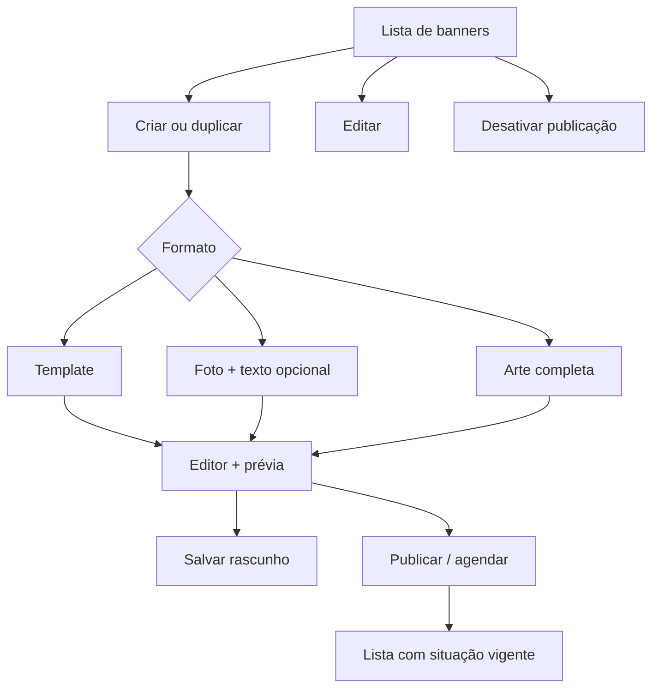
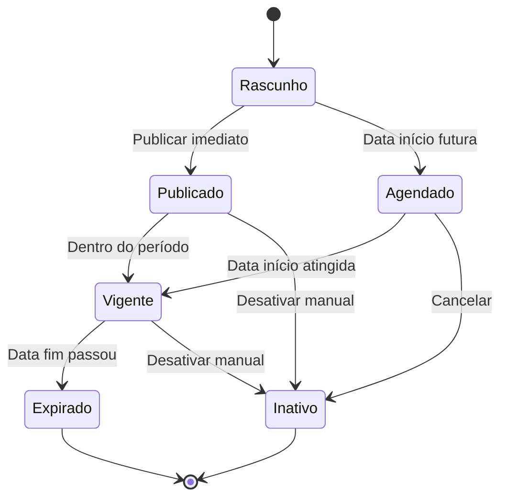
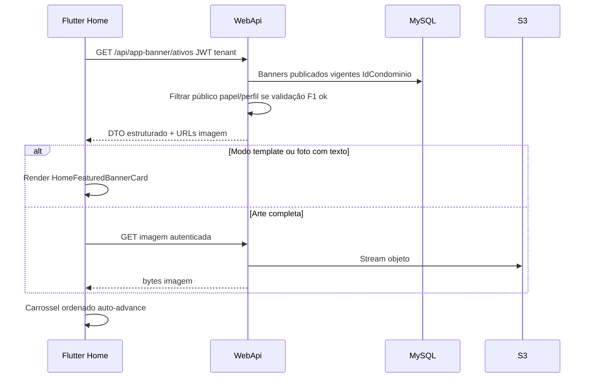
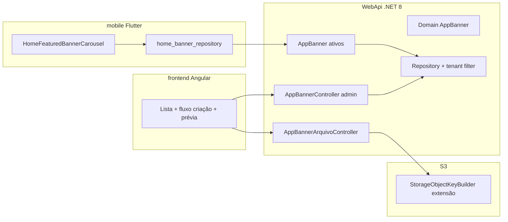
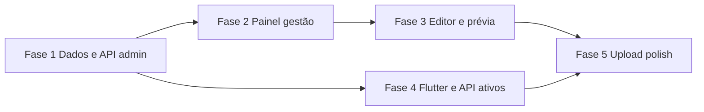

# Módulo Banners do App — Planejamento

**Projeto:** AppCondominium  
**Repositório:** `appCondominium`  
**Status:** Planejamento aprovado (direção técnica) — **sem implementação**  
**Última revisão:** 2026-11-15 (refino arte completa e validação de público)  

---

## 1. Visão geral e objetivo

O módulo **Banners do App** permite que síndicos e administradores do condomínio criem, publiquem e gerenciem destaques exibidos no **carrossel da Home** do aplicativo Flutter (`mobile/`), sem ferramentas externas de design.

Objetivos principais:

- Comunicar assembleias, avisos, manutenções e campanhas internas com aparência profissional.
- Oferecer três modalidades de conteúdo (template, foto com texto opcional, arte completa).
- Respeitar isolamento **multi-tenant** por condomínio e segmentação de público com base em **vínculos e perfis já existentes**.
- Priorizar banners em **modo template** renderizados no Flutter a partir de dados estruturados (sem gerar imagem por publicação).

---

## 2. Problema que o módulo resolve

Hoje o carrossel da Home mobile existe e segue o padrão visual Hug, mas os destaques vêm de **dados demonstrativos** (`HomeDemoData`), sem persistência nem painel de gestão. O síndico não consegue:

- Publicar avisos visíveis a moradores na abertura do app.
- Agendar início e fim de campanhas.
- Direcionar cliques para destinos internos ou links externos.
- Restringir exibição a grupos de moradores (papel de vínculo / perfil de acesso).

Este módulo fecha essa lacuna entre **comunicação do condomínio** e **experiência na Home**, reutilizando API .NET, Angular, S3, JWT/tenant e o widget `HomeFeaturedBannerCarousel` já implementado.

---

## 3. Experiência esperada do síndico

### Princípio: poucos campos, fluxo guiado (não burocrático)

As **cinco fases de implementação** (seção 9) são organização **técnica do projeto**, não um wizard de quatro etapas imposto ao usuário. Na interface, o síndico deve perceber um fluxo **contínuo e intuitivo**:

1. **Escolher como quer montar o banner** (três formatos — ver seção 5.1).
2. **Preencher o essencial** (título; demais campos conforme o formato).
3. **Ver prévia em tempo real** (como no app).
4. **Publicar agora** ou **agendar** — com opções avançadas (destino, público, ordem) recolhidas em “Mais opções”, não como obrigação inicial.

Referências de simplicidade e contrato visual:

- Angular: padrões `lst-*` / `cad-*` ([`.cursor/rules/hug-estilo-AppCondominium.mdc`](../.cursor/rules/hug-estilo-AppCondominium.mdc)).
- Upload de imagem: componente existente `app-imagem-upload` (como em Configuração do Condomínio).
- Cor padrão: pode herdar `ConfiguracaoCondominio.CorPadrao` quando o banner não definir cor própria.

O síndico **não** deve precisar de Photoshop, Canva ou exportação de PNG para o modo template.

---

## 4. Fluxos funcionais

### 4.1 Gestão (painel web)

### 4.2 Publicação e vigência

Situação exibida na lista: **Rascunho**, **Agendado**, **Vigente**, **Expirado**, **Inativo** (derivada de flags, datas e job lógico na consulta — sem workflow paralelo de autorização).

### 4.3 Consumo no app mobile

### 4.4 Lista vazia e banners indisponíveis

Comportamento **já adotado** no Flutter: se não houver destaques elegíveis, o carrossel **não ocupa espaço** (`SizedBox.shrink()`). Não exibir placeholder de erro na Home; falha de rede pode manter último cache curto ou omitir seção (decisão de implementação na Fase 4).

---

## 5. Requisitos e regras de negócio

### 5.1 Três formatos de banner (obrigatório no produto)

| Formato | Código interno sugerido | Conteúdo | Renderização Flutter |
|--------|-------------------------|----------|----------------------|
| **Template** | `Template` | Título, descrição/subtítulo, rótulo de ação, categoria/kind, modelo visual, cores (e ícone derivado do kind). Imagem lateral **opcional** (upload). | Card estruturado existente (`HomeFeaturedBannerCard`); **sem** PNG gerado no servidor. |
| **Imagem ou fotografia do síndico** | `FotoComTexto` | Imagem lateral obrigatória (foto real do condomínio, evento, etc.). Textos **opcionais** (título, subtítulo, ação) sobre o layout padrão do card. | Mesmo card com área lateral = foto via API/S3; textos exibidos se preenchidos. |
| **Arte completa enviada pelo síndico** | `ArteCompleta` | Um único arquivo de imagem (banner já desenhado). Textos na API **opcionais** só para acessibilidade/listagem admin; no app prioriza-se a arte. | Modo dedicado: ver regras de renderização abaixo; clique conforme destino configurado; sem sobrepor layout template se textos vazios. |

**Renderização do formato `ArteCompleta` (app mobile):**

- **Não** tornar `BoxFit.cover` o padrão obrigatório — `cover` pode cortar textos, logotipos e informações nas bordas.
- **Priorizar** preservação de proporção e exibição integral da arte: `BoxFit.contain` (ou equivalente) dentro da área do banner, com fundo neutro alinhado ao Hug se houver letterboxing.
- **Ocupar** a área disponível sem distorção (nunca esticar a imagem fora da proporção).
- **Corte (`cover` ou recorte manual):** somente se existir opção **consciente e controlada** (ex.: enquadramento escolhido pelo síndico no painel, com prévia); **nunca** aplicar corte automático por padrão na publicação.
- A foto no formato `FotoComTexto` (área lateral do card template) pode continuar usando `cover` na faixa lateral, pois o contexto é fotografia de apoio — distinto da arte completa.

Regras comuns:

- Todo banner pertence a um **único** `IdCondominio` (tenant).
- **Ordem de exibição:** `OrdemPrioridade` (menor número = mais prioritário); desempate por `IdBanner`.
- **Publicação:** `Publicado = true` e data/hora dentro de `[DataInicio, DataFim]` (fim nulo = sem expiração).
- **Destino ao clicar:** comunicado, evento, tela interna, link externo ou nenhum — ver seção 5.3.
- **Duplicar:** copia conteúdo e configurações; novo registro em rascunho; referência `IdBannerOrigem` opcional.
- Validação de arquivo: MIME e tamanho alinhados a `StorageMedia` (estender limites específicos para banner na implementação).

### 5.2 Segmentação de público (sem autorização paralela)

**Não** criar tabela ou motor de “autorização de banner” separado do restante do sistema.

Utilizar mecanismos **já existentes**:

| Mecanismo existente | Uso no módulo |
|--------------------|---------------|
| `ICondominioContext` / JWT `idCondominio` | Todo banner e toda listagem admin/mobile no tenant ativo. |
| `PessoaVinculo` + `CodigoPapelVinculo` (`PapelVinculoCodigos`) | Filtro “quem vê”: ex. apenas Morador, Proprietário, Funcionário, etc. |
| `IdPerfil` / `PerfilAcesso` + snapshot no login (`trocar-perfil`) | Filtro opcional por perfil administrativo ou de morador quando fizer sentido (ex.: banner só para perfil “Portaria”). |
| `PermissionResolver` / chave `APPBANNER` | **Somente** para telas de **gestão** no Angular (criar/editar/publicar), via `[PermissionResource]` — mesmo padrão dos demais CRUDs. |

Modelo sugerido no banner:

- `PublicoAlvoModo`: `Todos` | `PapeisVinculo` | `Perfis`
- `PublicoAlvoJson`: lista de códigos de papel e/ou `IdPerfil` — **interpretação na API** `GET /ativos` comparando o contexto autenticado da sessão, sem nova tabela de permissão.

**Distinção obrigatória:** `CodigoPapelVinculo` (papel no vínculo com o condomínio/unidade, ex. Morador, Síndico) e `IdPerfil` (perfil de acesso RBAC da sessão) **não** são a mesma informação. O planejamento do filtro deve tratar cada modo (`PapeisVinculo` vs `Perfis`) com regras separadas; não unificar ou presumir equivalência.

**Validação técnica prévia (obrigatória antes de implementar filtro de público):**

Antes de codificar a segmentação no endpoint `GET /ativos` e no app, a **Fase 1** deve produzir um registro objetivo (nota no PR ou subseção do README técnico do módulo) confirmando:

1. Se `CodigoPapelVinculo` e `IdPerfil` estão **efetivamente disponíveis** nas claims JWT e/ou no contexto autenticado (`ICondominioContext`, serviços de acesso já usados no login e em `trocar-perfil` / `trocar-condominio`).
2. Se o **papel de vínculo** usado no filtro corresponde ao vínculo **válido** da pessoa no **condomínio ativo** (ex.: consulta coerente com `PessoaVinculo` e vigência), e não a um valor genérico ou de outro tenant.
3. Qual fonte canônica usar em cada caso (claim direta vs. resolução via serviço existente), **reutilizando** autenticação, vínculo e autorização atuais — sem estruturas paralelas.

A **Fase 4** só implementa o filtro por público-alvo (`PapeisVinculo` / `Perfis`) se a validação da Fase 1 estiver **aprovada**. Até lá, o endpoint `GET /ativos` pode retornar banners em modo `PublicoAlvoModo = Todos` ou documentar filtro desligado por feature flag. Modo `Todos` não depende dessa validação.

Moradores **não** precisam da permissão `APPBANNER`; apenas autenticação válida no condomínio e match de público (quando o filtro estiver habilitado).

### 5.3 Destinos de clique

| Tipo | MVP | Observação |
|------|-----|------------|
| Nenhum / informativo | Sim | Só exibe; ação opcional oculta. |
| Link externo | Sim | URL validada; abrir com política de segurança no app. |
| Rota interna (deep link / GoRouter) | Sim | Catálogo fechado de rotas mobile documentado na Fase 4. |
| Comunicado | Preparado | Entidade comunicado **ainda não existe** no backend; armazenar `Id` reservado + UI “em breve” ou vínculo manual até módulo existir. |
| Evento | Preparado | Idem comunicado. |

### 5.4 Histórico

- **MVP:** campos de auditoria na entidade (`CriadoEm`, `CriadoPorIdPessoa`, `AtualizadoEm`, `PublicadoEm`, `AtualizadoPorIdPessoa` se disponível no padrão do projeto).
- **Evolução posterior:** tabela `AppBannerHistorico` com eventos (publicou, desativou, alterou vigência) — **fora do MVP** para evitar complexidade.

---

## 6. Arquitetura proposta

### 6.1 Camadas

### 6.2 O que reutilizar vs construir

| Componente | Situação |
|-----------|----------|
| `HomeFeaturedBannerCarousel` / `HomeFeaturedBannerCard` | **Existe** — estender para arte completa (`contain` por padrão) e `Image.network` |
| `HomeDemoData` / providers | **Existe** — substituir por API na Fase 4 |
| CRUD gerado + tenant filters | **Padrão existe** — nova entidade via spec/gerador + migration |
| `ConfiguracaoCondominioArquivoController` + `ArquivoAplicacao` | **Existe** — espelhar para imagens de banner |
| `app-imagem-upload`, `lst-*`, `cad-*` | **Existe** — nova feature `app-banner` |
| Convites (feature custom) | **Referência** para ações além do CRUD (duplicar, publicar) |
| Entidade Banner / endpoints | **A construir** |
| Editor com prévia + catálogo de modelos | **A construir** (Fase 3) |
| RBAC `APPBANNER` no catálogo JSON | **A construir** (Fase 1) |

### 6.3 Cache e atualização (mobile)

- Endpoint `GET /api/app-banner/ativos`: `Cache-Control: private, max-age=60` (ajustável).
- Campo `Versao` (uint) por banner, incrementado em alterações que afetam exibição; cliente pode enviar `If-None-Match` / versão agregada (detalhe na implementação).
- Refresh ao trocar condomínio/perfil (`tenantContextGenerationProvider` já usado na Home).

### 6.4 Segurança

- Admin: `[Authorize]` + `[PermissionResource("APPBANNER")]` + tenant.
- Upload: validação MIME (`StorageMedia.ImagensTema`), tamanho máximo documentado, `TenantConfere` como em configuração.
- Stream de imagem: bucket privado; bytes via API autenticada (não URL pública S3).
- Link externo: validação de esquema `https` (e exceções documentadas se houver).

---

## 7. Modelo de dados sugerido

### 7.1 Tabela `AppBanner`

Escopo tenant: `IdCondominio` com global query filter (padrão `AppDbContext.TenantFilters.Generated.cs`).

| Campo | Tipo | Descrição |
|-------|------|-----------|
| `IdBanner` | INT UNSIGNED AI | PK |
| `IdCondominio` | INT UNSIGNED | FK Condomínio |
| `Formato` | TINYINT / ENUM | `Template`, `FotoComTexto`, `ArteCompleta` |
| `Titulo` | VARCHAR(120) | Obrigatório exceto arte completa sem texto (opcional) |
| `Subtitulo` | VARCHAR(255) NULL | |
| `RotuloAcao` | VARCHAR(60) NULL | |
| `CategoriaRotulo` | VARCHAR(40) NULL | Ex.: “Comunicado”, “Assembleia” |
| `Kind` | TINYINT NULL | Alinhado a `HomeHighlightKind` |
| `ModeloTemplateId` | VARCHAR(40) NULL | Só formato Template |
| `CorDestaque` | CHAR(7) NULL | `#RRGGBB`; fallback `ConfiguracaoCondominio.CorPadrao` |
| `TemImagemLateral` | BOOL | Indica objeto no S3 |
| `TemArteCompleta` | BOOL | Imagem full-bleed |
| `Publicado` | BOOL | |
| `DataInicio` | DATETIME NULL | Agendamento |
| `DataFim` | DATETIME NULL | Expiração |
| `OrdemPrioridade` | INT | Default 100 |
| `Versao` | INT UNSIGNED | Cache |
| `TipoDestino` | TINYINT | Enum destino |
| `DestinoPayload` | JSON NULL | ids, url, rota |
| `PublicoAlvoModo` | TINYINT | Todos / Papeis / Perfis |
| `PublicoAlvoJson` | JSON NULL | |
| `IdBannerOrigem` | INT UNSIGNED NULL | Duplicação |
| `CriadoEm` | DATETIME | |
| `CriadoPorIdPessoa` | INT UNSIGNED NULL | |
| `AtualizadoEm` | DATETIME NULL | |
| `PublicadoEm` | DATETIME NULL | |

Índices sugeridos:

- `IdxAppBannerCondominioPublicacao` (`IdCondominio`, `Publicado`, `OrdemPrioridade`)
- `IdxAppBannerVigencia` (`IdCondominio`, `DataInicio`, `DataFim`)

### 7.2 Armazenamento S3 (sem coluna BLOB)

Estender `StorageObjectKeyBuilder`:

- Lateral: `{condominio}/funcionalidades/banners-app/{idBanner}/lateral`
- Arte completa: `{condominio}/funcionalidades/banners-app/{idBanner}/arte-completa`

Limpeza via `ArquivoCleanupInterceptor` ao excluir banner (padrão existente).

### 7.3 DTO mobile (`AppBannerAtivoDto`)

Espelho de `HomeFeaturedHighlight`:

- `id`, `kind`, `categoryLabel`, `title`, `subtitle`, `actionLabel`, `sortOrder`
- `formato` + flags de render
- `imageUrl` opcional (rotas GET da API)
- `destination` + payload resolvido

---

## 8. Integrações e segurança

| Integração | Detalhe |
|------------|---------|
| MySQL `condominium` | Migration incremental via `AppCondominium.Tools` (padrão README) |
| AWS S3 | Mesmo bucket/prefixo `app-condominium/{env}/condominios/...` |
| JWT + `X-Id-Condominio` | Obrigatório; alinhamento com `TenantHostService` no Angular |
| RBAC | Nova entrada em `docs/rbac/funcionalidades-catalogo.json`: módulo Condomínio, rota `/app-banner`, chave `APPBANNER` |
| Geração de código | Atualizar `MDs/md_appCondominium.json` + `tools/generate_from_spec.py` na Fase 1 |
| Flutter `mobile/` | Dio + `ApiPaths`; **não** escopo do app legado `AppCondominium/` neste módulo |

---

## 9. Planejamento por fases

As **cinco fases** e dependências originais são mantidas.

A seta F1 → F4 inclui a **validação de claims/contexto** para público; o filtro segmentado na F4 fica condicionado a esse resultado (seção 5.2).

### Fase 1 — Fundação dados e API admin

**Objetivo:** persistência, tenant, RBAC e CRUD administrativo.

**Escopo:**

- Entidade `AppBanner`, migration, query filter, registro no gerador/spec.
- `AppBannerController` (padrão gerado + endpoints de duplicar e patch publicação).
- Permissão `APPBANNER`.
- **Validação técnica de segmentação de público** (seção 5.2): mapear disponibilidade e semântica de `CodigoPapelVinculo` e `IdPerfil` no JWT/contexto; confirmar vínculo no condomínio ativo; documentar decisão para uso na Fase 4.

**Projetos:** `WebApi/`, `database/`, `docs/rbac/`.

**Critérios de conclusão:**

- CRUD isolado por condomínio (testes automatizados).
- Usuário sem permissão recebe 403.
- Entregue relatório/ata de validação de claims e vínculos para filtro de público (aprovado ou com lacunas explícitas).

**Testes:** testes de repositório/tenant; testes de autorização RBAC; inspeção documentada de claims após login/troca de perfil e condomínio (não presume implementação do filtro ainda).

### Fase 2 — Painel web gestão (fluxo simples)

**Objetivo:** síndico gerencia banners sem editor avançado.

**Escopo:**

- Lista `lst-*` com situação, período, ordem, duplicar, desativar.
- Formulário único com seções lógicas (não wizard de quatro etapas): escolha dos **três formatos**, campos essenciais, “Mais opções” para destino/público/agenda.
- Rotas e item de menu no grupo Condomínio.

**Projetos:** `frontend/`.

**Dependências:** Fase 1.

**Critérios de conclusão:**

- Criar banner template em rascunho e publicar imediato.
- Listar estados coerentes (vigente/expirado).

**Testes:** smoke manual; testes de serviço HTTP se houver padrão no projeto.

### Fase 3 — Editor visual, modelos e prévia

**Objetivo:** criação assistida sem design externo.

**Escopo:**

- Catálogo fixo de 3–5 modelos template (JSON no frontend).
- Seletor de cores (incl. cor do condomínio).
- Prévia ao vivo aproximando `HomeFeaturedBannerCard`.
- Suporte explícito aos três formatos na UI.

**Projetos:** `frontend/`.

**Dependências:** Fase 2.

**Critérios de conclusão:**

- Prévia template coerente com mobile.
- Formato foto com texto opcional e arte completa selecionáveis com UX clara.

**Testes:** testes de componente da prévia (se aplicável).

### Fase 4 — Integração Flutter e endpoint ativos

**Objetivo:** carrossel consome API real.

**Escopo:**

- `GET /api/app-banner/ativos` com filtro de **vigência**; filtro de **público** somente se a validação da Fase 1 estiver aprovada (papéis e perfis via mecanismos existentes, sem autorização paralela).
- Repository Riverpod; substituir demo em `home_providers.dart`.
- Render dos três formatos (arte completa com `contain` por padrão; ver seção 5.1); destinos implementados no escopo disponível.
- Comportamento lista vazia / expirado mantido.

**Projetos:** `mobile/`, `WebApi/`.

**Dependências:** Fase 1 (API + **ata de validação de público**); pode paralelizar integração com mocks, mas filtro segmentado e homologação de público exigem validação aprovada.

**Critérios de conclusão:**

- Morador autenticado vê apenas banners do seu condomínio.
- Com validação aprovada: público compatível (papel de vínculo e/ou perfil, conforme modo do banner).
- Ordenação e auto-advance preservados.

**Testes:** `home_viewport_metrics_test.dart` atualizado; testes de widget com lista fake/API mock.

### Fase 5 — Upload S3, validações e homologação

**Objetivo:** imagens laterais e arte completa em produção; polimento.

**Escopo:**

- `AppBannerArquivoController` (PUT/GET/DELETE) + chaves S3.
- Validação dimensões recomendadas (documentação UX: proporção lateral ~ área `HomeLayout.bannerImageWidth`).
- Campos de auditoria preenchidos; **sem** tabela de histórico detalhado.

**Projetos:** `WebApi/`, `frontend/`, `mobile/`.

**Dependências:** Fases 3 e 4.

**Critérios de conclusão:**

- Três formatos ponta a ponta em ambiente de homologação.
- Checklist de aceite (seção 10) assinado.

**Testes:** testes de upload (`StorageTests` estilo); teste E2E manual síndico → morador.

---

## 10. Critérios de aceite e homologação

### 10.1 Funcionais (MVP)

- [ ] Listar, criar, editar, duplicar e desativar banners no painel.
- [ ] Três formatos: template, foto com texto opcional, arte completa.
- [ ] Publicação imediata e agendada com data fim opcional.
- [ ] Carrossel na Home com 0..N banners; 0 = sem área vazia.
- [ ] Ordem por prioridade configurável.
- [ ] Destino: link externo e rota interna mínima; comunicado/evento preparados no modelo.
- [ ] Público: todos; por papel de vínculo e/ou perfil **somente após** validação Fase 1 aprovada, **sem** novo sistema de permissão e sem confundir papel de vínculo com perfil RBAC.
- [ ] Isolamento: condomínio A não vê banners do condomínio B.

### 10.2 Não funcionais

- [ ] Imagens no S3; sem BLOB no MySQL.
- [ ] Upload rejeita tipo/tamanho inválidos com mensagem clara (padrão `ArquivoAplicacao`).
- [ ] Gestão exige `APPBANNER`; leitura mobile exige sessão válida no tenant.

### 10.3 Homologação sugerida

1. Síndico cria banner **template** → morador vê na Home em até 1 minuto (cache).
2. Síndico agenda banner futuro → não aparece antes; aparece após `DataInicio`.
3. Banner expirado some do carrossel após `DataFim`.
4. Banner só para `Morador` não aparece para sessão `Funcionario` (e vice-versa, conforme configurado) — **apenas** com filtro de público habilitado após validação Fase 1.
5. Arte completa exibe a **integralidade** da arte sem distorção (`contain` ou equivalente); textos e logotipos nas bordas permanecem visíveis; sem corte automático por padrão; se houver enquadramento manual, resultado igual à prévia do painel.
6. Duplicar gera novo rascunho independente.

---

## 11. Riscos e decisões pendentes

| Item | Risco / decisão | Mitigação / prazo |
|------|-----------------|-------------------|
| Comunicado/Evento inexistentes | Destino sem tela de destino | Enum + payload; UI admin desabilita ou valida ID quando módulos existirem |
| Nome da chave RBAC | `APPBANNER` vs outro | Definir na Fase 1 alinhado ao gerador de catálogo |
| Crop de imagem no Angular | UX de enquadramento | Arte completa: `contain` no mobile; crop opcional só com prévia consciente; lateral `FotoComTexto` pode usar `cover` na faixa |
| Claims papel vs perfil | Filtro incorreto ou falta de dados no JWT | Validação obrigatória na Fase 1; Fase 4 condicionada; não presumir equivalência |
| Arte completa vs template | Regressão visual | Testes visuais Hug; dimensões mínimas documentadas; homologar bordas legíveis |
| Cache stale | Morador vê banner antigo | `Versao` + TTL curto + pull-to-refresh futuro |
| App Flutter legado | Duplicação de esforço | Escopo oficial: apenas `mobile/` |
| Histórico detalhado | Escopo creep | Explicitamente **pós-MVP** |

---

## 12. Evoluções futuras (não dependências do MVP)

- IA para sugerir títulos, descrições e combinações de modelo/cor.
- Transformar comunicado cadastrado em banner.
- Biblioteca de modelos por categoria (assembleia, obra, festa).
- Estatísticas de impressões e cliques.
- Reaproveitamento de banners de campanhas anteriores.
- Tabela `AppBannerHistorico` e timeline na tela de detalhe.
- Público por bloco/unidade (exigiria extensão sobre `PessoaVinculo`/unidade).
- Geração opcional de PNG server-side (somente se houver demanda legal/exportação).

---

## Anexo A — Endpoints sugeridos (referência)

| Método | Rota | Uso |
|--------|------|-----|
| GET | `/api/app-banner` | Lista paginada admin |
| GET | `/api/app-banner/{id}` | Detalhe admin |
| POST | `/api/app-banner` | Criar |
| PUT | `/api/app-banner/{id}` | Atualizar |
| DELETE | `/api/app-banner/{id}` | Excluir |
| POST | `/api/app-banner/{id}/duplicar` | Duplicar |
| PATCH | `/api/app-banner/{id}/publicacao` | Publicar/desativar/datas |
| PUT/GET/DELETE | `/api/app-banner/{id}/imagem-lateral` | Foto lateral |
| PUT/GET/DELETE | `/api/app-banner/{id}/arte-completa` | Arte completa |
| GET | `/api/app-banner/ativos` | Lista mobile filtrada |

---

## Anexo B — Arquivos de referência analisados

**Flutter (`mobile/`):**

- `lib/features/home/domain/models/home_models.dart`
- `lib/features/home/presentation/widgets/home_featured_banner.dart`
- `lib/features/home/presentation/providers/home_providers.dart`
- `lib/features/home/data/home_demo_data.dart`
- `lib/features/home/presentation/theme/home_layout.dart`
- `mobile/docs/hug-estilo-mobile.md`

**Angular (`frontend/`):**

- `src/app/app.routes.ts`, `src/app/app.component.ts`
- `src/app/features/configuracaocondominio/*`
- `src/app/features/convite/convite-list.component.ts`
- `src/app/shared/imagem-upload/imagem-upload.component.ts`

**WebApi:**

- `AppCondominium.API/Controllers/ConfiguracaoCondominioArquivoController.cs`
- `AppCondominium.API/Storage/ArquivoAplicacao.cs`
- `AppCondominium.Application/Storage/StorageObjectKeyBuilder.cs`, `StorageMedia.cs`
- `AppCondominium.Infrastructure/Persistence/AppDbContext.cs` (tenant)
- `AppCondominium.Domain/Vinculos/PapelVinculoCodigos.cs`
- `AppCondominium.API/Controllers/AuthController.cs` (perfil/papel na sessão)

**Documentação e regras:**

- `README.md` (multi-tenant, S3, gerador)
- `.cursor/rules/hug-estilo-AppCondominium.mdc`, `hug-estilo-mobile.mdc`
- `docs/rbac/funcionalidades-catalogo.json`
- `database/schema.sql`

---

*Documento de planejamento — nenhuma funcionalidade implementada, nenhum código de produção alterado, nenhuma migration executada.*