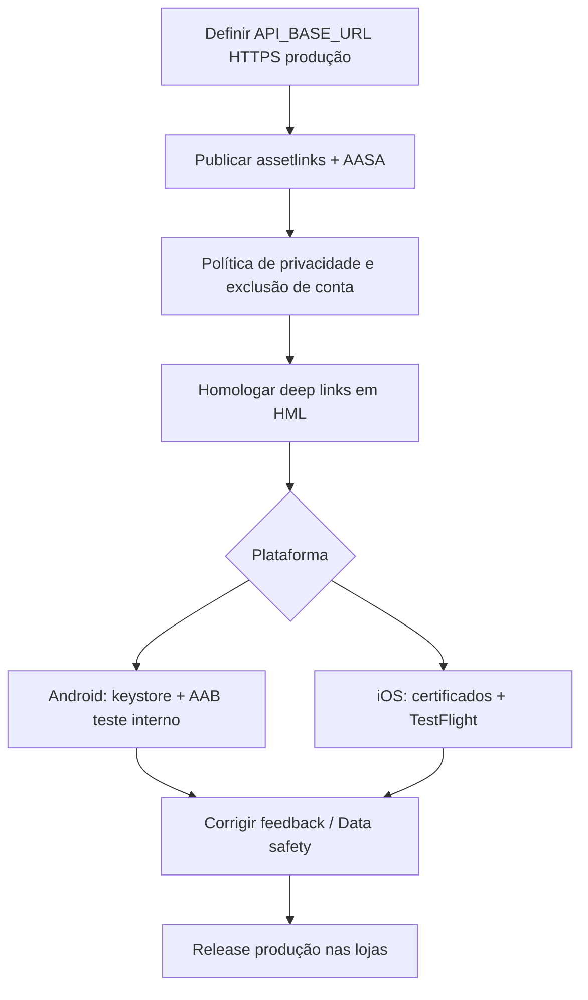

# Publicação nas lojas — checklist único (Fase 7.4)

Checklist consolidado para **Google Play** e **Apple App Store**, integrando o trabalho das Fases **7.1** (Android / App Links), **7.2** (iOS / Universal Links) e **7.3** (validação de API HTTPS em produção). Detalhes por plataforma continuam em:

- [`android-publicacao-homologacao.md`](./android-publicacao-homologacao.md)
- [`ios-publicacao-homologacao.md`](./ios-publicacao-homologacao.md)

**Escopo desta fase:** preparação e documentação. **Não** inclui deploy, geração de certificados/chaves, alteração de `applicationId` / Bundle ID nem build iOS no Windows.

---

## Identidade e versão (comum)

| Item | Valor verificado |
|------|------------------|
| Pacote Android | `br.com.appcondominium.mobile` |
| Bundle ID iOS | `br.com.appcondominium.mobile` |
| Nome exibido | AppCondominium |
| Versão | `1.0.0` + build `1` (`pubspec.yaml` → `versionName` / `versionCode` / `CFBundleShortVersionString` / `CFBundleVersion`) |
| Legado (`AppCondominium/`) | IDs distintos — convivência na migração (`mobile/README.md`) |

---

## Requisitos já atendidos

### Android

- [x] `applicationId` e `namespace` alinhados (`android/app/build.gradle.kts`).
- [x] SDK via Flutter 3.41.4: `minSdk` **24**, `targetSdk` / `compileSdk` **36** (padrão do Flutter — adequado aos requisitos atuais da Play Store; revalidar no momento do envio).
- [x] App Links HTTPS com `autoVerify` para `appcondominium.com.br` (`/convite/aceitar`, `/recuperacao-senha/redefinir`).
- [x] Modelo `assetlinks.json` sem fingerprints reais: [`android-app-links-assetlinks.template.json`](./android-app-links-assetlinks.template.json).
- [x] Permissão explícita no manifest principal: `INTERNET`.
- [x] `.gitignore` prevê `key.properties` (sem chaves no repositório).
- [x] API de produção: validação em `AppConfig` exige `API_BASE_URL` HTTPS e não local quando `APP_ENV=production`/`prod` (`lib/core/config/app_config.dart` + testes em `test/app_config_test.dart`).
- [x] Log HTTP sensível redigido; logging desligado em produção.

### iOS

- [x] Bundle Identifier consistente no Xcode (`project.pbxproj`).
- [x] Deployment Target **13.0**.
- [x] Associated Domains: `applinks:appcondominium.com.br` (`Runner.entitlements`).
- [x] `FlutterDeepLinkingEnabled` em `Info.plist`.
- [x] Modelo AASA: [`ios-universal-links-apple-app-site-association.template.json`](./ios-universal-links-apple-app-site-association.template.json).
- [x] `NSFaceIDUsageDescription` para uso futuro de biometria (`local_auth`).
- [x] ATS padrão (sem exceções HTTP em `Info.plist`).
- [x] Conjunto `AppIcon.appiconset` completo, incluindo ícone de marketing **1024×1024**.
- [x] `CODE_SIGN_STYLE = Automatic`; entitlements de release/debug apontam para `Runner.entitlements` (Team ID / perfis ficam no macOS).

### Segurança no app

- [x] JWT e metadados de sessão em `flutter_secure_storage` (`lib/core/security/token_storage.dart`).
- [x] Preferência de unidade em `SharedPreferences` (apenas ID numérico — `unit_preference_store.dart`).
- [x] Sem credenciais fixas; base da API via `--dart-define`.

### Validação automatizada (Windows)

Última execução na Fase 7.4:

```bash
cd mobile
flutter analyze   # No issues found!
flutter test      # 72 testes — todos passaram
```

---

## Pendências — Android (Google Play)

| Prioridade | Pendência | Ação manual |
|------------|-----------|-------------|
| Alta | Assinatura **release** ainda usa keystore **debug** | Criar keystore de upload; configurar `signingConfigs` + `key.properties` (não versionar); ver [documentação Flutter](https://docs.flutter.dev/deployment/android#signing-the-app) |
| Alta | URL final `API_BASE_URL` de produção | Definir com operação/back-end; builds: `flutter build appbundle --dart-define=APP_ENV=production --dart-define=API_BASE_URL=https://...` |
| Alta | `assetlinks.json` em produção | Publicar em `https://appcondominium.com.br/.well-known/assetlinks.json` com SHA-256 do certificado de **assinatura** (Play App Signing) |
| Alta | Política de privacidade (URL) | Obrigatória na Play Console — redigir e hospedar fora do app |
| Média | **Ícone adaptativo** | Não há `mipmap-anydpi-v26` / `ic_launcher.xml`; apenas `ic_launcher` em densidades fixas — substituir arte padrão Flutter pela marca |
| Média | **Splash nativa** | `launch_background.xml` com fundo branco (sem marca) — alinhar ao Hug / identidade |
| Média | Play Console | Classificação de conteúdo, Data safety, screenshots, descrições, track de teste interno/fechado |
| Baixa | FCM | Dependências no `pubspec.yaml`; sem `google-services.json` / inicialização Firebase no código ainda |
| Baixa | Biometria | `local_auth` no `pubspec.yaml`; permissões `USE_BIOMETRIC` vêm do merge de manifest do plugin quando a feature for ligada |

### Geração futura do AAB (sem executar release assinado aqui)

```bash
flutter build appbundle \
  --dart-define=APP_ENV=production \
  --dart-define=API_BASE_URL=https://SUA_API_PRODUCAO
```

Revisar na Play Console requisitos vigentes (ex.: alinhamento de bibliotecas nativas / página de memória 16 KB) no primeiro upload.

---

## Pendências — iOS (App Store / TestFlight)

| Prioridade | Pendência | Ação manual (macOS) |
|------------|-----------|---------------------|
| Alta | Conta **Apple Developer Program** e App ID com **Associated Domains** | Portal Apple + Xcode *Signing & Capabilities* |
| Alta | **Team ID** e provisioning de **distribuição** | Não commitar `DEVELOPMENT_TEAM`; configurar no Xcode local |
| Alta | AASA em produção | Publicar `apple-app-site-association` com Team ID real (template na pasta `docs/`) |
| Alta | URL de política de privacidade | App Store Connect |
| Média | **LaunchScreen** / `LaunchImage` | Storyboard padrão Flutter — alinhar visual à marca (sem alterar automaticamente no repositório) |
| Média | Revisar **1024×1024** e ícones | Confirmar arte final da marca (sem canal alpha inadequado) |
| Média | TestFlight | `flutter build ipa` + Transporter ou Xcode Organizer; metadados e formulário de privacidade no Connect |
| Baixa | Push / Firebase | Sem `GoogleService-Info.plist`, sem `aps-environment` — habilitar quando FCM for integrado |
| Baixa | Biometria | `local_auth` ainda não referenciado no código; descrição Face ID já está no `Info.plist` |

```bash
flutter build ipa \
  --dart-define=APP_ENV=production \
  --dart-define=API_BASE_URL=https://SUA_API_PRODUCAO
```

**Não** executar build iOS neste ambiente Windows.

---

## Identidade visual — o que revisar (sem trocar imagens automaticamente)

| Área | Estado | Ajuste sugerido |
|------|--------|-----------------|
| Android launcher | `ic_launcher` (provável padrão Flutter) | Ícone final + ícone adaptativo (foreground/background) |
| Android splash | Fundo branco | Logo/cores do [`hug-estilo-mobile.md`](./hug-estilo-mobile.md) |
| iOS App Icon | Set completo + 1024 | Validar com design/marketing |
| iOS Launch | `LaunchScreen.storyboard` + `LaunchImage` genéricos | Splash alinhada à marca |
| In-app splash | `SplashPage` + `AppBrandMark` | Texto “Fundação mobile…” ainda provisório para loja pública |

Ferramentas como `flutter_launcher_icons` / `flutter_native_splash` **não** estão configuradas no `pubspec.yaml` do app novo — decisão de adoção fica com o time.

---

## Privacidade, permissões e dados (apoio às declarações das lojas)

> **Aviso:** isto **não** é política de privacidade nem declaração legal. Use apenas como inventário técnico para preencher Play Console, App Store Connect e redigir a política com jurídico/DPO.

### Permissões e capacidades

| Origem | Android | iOS |
|--------|---------|-----|
| App (`AndroidManifest.xml`) | `INTERNET` | — |
| Plugins (quando usados) | `USE_BIOMETRIC` / biometria via `local_auth` (merge) | Face ID / Touch ID (`NSFaceIDUsageDescription`) |
| Push (futuro) | `POST_NOTIFICATIONS` (Android 13+), FCM | Push capability + APNs |
| Não identificado | Câmera, localização, contatos, armazenamento amplo | Idem |

### Dados pessoais tratados (fluxos atuais no código)

| Categoria | Exemplos no app | Onde |
|-----------|-----------------|------|
| Identificação / conta | E-mail ou usuário, senha (transmissão) | Login, vínculos (`auth_repository.dart`) |
| Nome e perfil | Nome, perfil, permissões | Resposta de login → `StoredSession` (armazenamento seguro) |
| Dados de condomínio | IDs e nomes de condomínio, unidades | API + preferência local (`SharedPreferences`) |
| Convite / cadastro | Nome, CPF, e-mail, data de nascimento, telefone opcional, senha | Envio à API (`convite_repository.dart`) |
| Recuperação de senha | E-mail | `password_recovery_repository.dart` |
| Tokens | JWT de acesso | `flutter_secure_storage` |
| Deep links | `token` em query (convite / senha) | Rotas públicas; log redige tokens em dev |

**Não** persistir senha no dispositivo. Logout limpa token e metadados (`TokenStorage.clearSession`).

### Requisitos de loja e produto (pendências de negócio/jurídico)

| Requisito | Situação no app | Observação |
|-----------|-----------------|------------|
| Política de privacidade (URL pública) | Não definida no repositório | Obrigatória em ambas as lojas |
| Exclusão de conta | Apenas **logout** local | Google e Apple exigem caminho de exclusão quando há criação de conta — convite ativa conta; validar se a exclusão será in-app, via web ou suporte + documentar na política |
| Direitos do titular (LGPD) | Depende da operação/back-end | O app é cliente da WebApi; bases legais e retenção não estão no mobile |
| Criptografia em trânsito | HTTPS obrigatório em produção (`AppConfig`) | Declarar nas lojas conforme coleta real |
| Crianças / classificação etária | Não avaliado no código | Preencher questionários nas consoles |

---

## Configurações manuais necessárias (resumo)

1. **Back-end / infra:** URL HTTPS de produção; publicar `assetlinks.json` e AASA no domínio `appcondominium.com.br`.
2. **Jurídico / produto:** política de privacidade, termos, fluxo de exclusão de conta e texto para Data safety / Privacy Nutrition Labels.
3. **Android:** keystore, assinatura release, arte (ícone adaptativo + splash), Play Console (tracks, metadados).
4. **iOS (macOS):** Apple Developer, certificados/profiles, Team ID, AASA, TestFlight, metadados no App Store Connect.
5. **Marca:** substituir ícones e telas de abertura provisórias; revisar copy da splash in-app antes de release público.
6. **Opcional futuro:** Firebase (`google-services.json`, `GoogleService-Info.plist`), notificações push, biometria funcional.

---

## Ordem recomendada — homologação e publicação



1. Congelar `API_BASE_URL` de homologação e produção; builds com `APP_ENV=production` só após URL definitiva.
2. Publicar arquivos de verificação de links no domínio e testar convite/redefinição de senha em dispositivos reais.
3. Publicar política de privacidade e alinhar fluxo de exclusão de conta com a API.
4. Atualizar identidade visual (ícones/splash) e remover textos provisórios visíveis ao usuário final.
5. **Android:** configurar assinatura → track interno → testes fechados → produção.
6. **iOS:** primeiro upload TestFlight → testadores → revisão App Store.
7. Após estabilização, habilitar FCM/push e biometria se fizer parte do escopo do release.

---

## Referência rápida — variáveis de build

| Chave | Padrão | Produção |
|-------|--------|----------|
| `APP_ENV` | `development` | `production` ou `prod` |
| `API_BASE_URL` | `http://localhost:5000` | HTTPS público (obrigatório) |
| `API_LOGGING` | `true` | Ignorado (desligado em produção) |

---

*Documento gerado na Fase 7.4. Revisar antes de cada envio às lojas — requisitos das consoles e das políticas mudam periodicamente.*